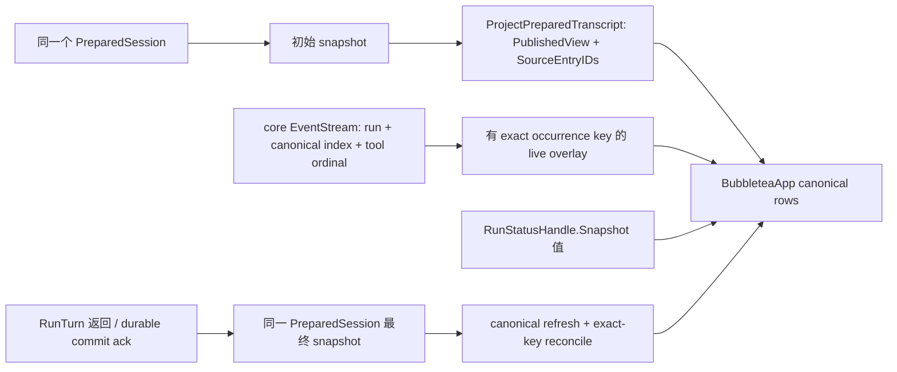

# R5 durable transcript 到 R8 TUI app integration handoff

状态：builder handoff 定点修订稿，待 root 与原独立 reviewer 复核；本文不修改产品源码、不更新任务台账，也不把未提交 worktree 当作最终实现。源码核对基线固定为 `codex/runtime-repair-20260929` 的 `182e1bf9271b92e6cbca518e9f0d41408d82bfce`；当前 HEAD `1144e1e` 后续仅新增 ACP source/review 与闭环文档，没有 UI/core/CLI 目标源码变化。范围限于 R5→R8 UI app integration；R9 deferred。目标是冻结 R5 的 snapshot/overlay 权威边界，再交给 R8 接通已接受的 viewport primitive 与增量渲染；不重做 viewport primitive。

依据：[`r5-ui-design.md`](../2026-09-25-runtime/r5-ui-design.md)、[`r8-viewport-handoff.md`](../2026-09-25-runtime/r8-viewport-handoff.md)、[`resume-plan.md`](resume-plan.md)、R5 keyed transcript/adapter 与 live projection reviews、[`r8-viewport-model-final-review.md`](../2026-09-25-runtime/reviews/r8-viewport-model-final-review.md)。本文不替代这些合同，不声称 R2/R5/R8 已闭环。

## 决策与前置条件

R5 是唯一把默认 REPL 绑定到 durable `PreparedSession` 的 owner；R8 只消费其稳定的 canonical snapshot 与 live overlay seam。TUI 不维护第二份可被误认作历史的 transcript。一个 app 的 durable truth 是同一物理 session、同一 branch 的 `CanonicalTranscriptSnapshot`；R1 运行状态、R2 持久化确认和实时事件是彼此独立的输入。

R8 builder 仅在下列 source slices 已独立接受并集成后开始：

| 前置 slice | 必须交出的稳定合同 | 当前源码/证据缺口 |
|---|---|---|
| R2 durable CLI | REPL 持有本轮所选的同一个 `PreparedSession`，provider dispatch 前可 snapshot，RunTurn 返回后可从同一 handle 刷新并验证 session/branch 未切换。 | 独立 review 的 `4de967c` 候选有 P2，尚未接受；R5 开工前须复核修正后的准确集成 SHA。pending worktree 不是交付证据。 |
| R5 canonical adapter 与 live overlay | 从 `PublishedView.Messages` 与配对的 `SourceEntryIDs` 得到 canonical rows；事件仅为 provisional；有 exact correlation 才能替换同一 row。 | canonical DTO/projection 已独立接受，但尚未接到 `BubbleteaApp` snapshot/overlay。source 有稳定 `TranscriptIndex`，assistant occurrence key 与 typed `AgentEvent` coordinates 仍待接线。 |
| R5 status/backpressure | 运行状态以不可变 `RunStatusHandle.Snapshot()` 采样；best-effort event gap 标 incomplete；关键刷新必须等待 model-apply ack。 | `6ca35e3` 已集成并接受：`Send` 返回有类型的队列错误，`CriticalSendContext` 等待队列空间/本轮 generation。它们没有提供 model-apply ack；refresh 仍是 app integration 缺口。 |
| R3 stream ownership join（core 文件前置） | core event correlation 开始编辑 `loop.go` / stream sink 前，重叠的 stream owner 已被接受并集成。 | `cc195` 独立 review 有 P2，尚未接受；修正并复核前不得把其 pending worktree 当作可释放的文件依赖。 |
| R8 stream renderer | 使用已接受的 `AppendChunk` bounded-window API，再释放 `streaming_markdown.go` 给 app owner。 | `4dc8` fix 已由 `11d81a1` 集成，`74e3375` review 记录 ACCEPT。`app.go` 仍对累计前缀调用 `RenderIncremental`，所以 app 接线仍未完成；此 renderer/viewport primitive 不重做。 |

当前 app 生命周期也需要 R5 先调整：`waitForTurnCompletion` 把 bridge channel close 当作 app `Done`，然后 `executeTurn` 才等待 `turnDone`。最终 snapshot 因而没有机会在仍可显示/可 ack 的 app 中应用。事件源关闭只表示本轮不再有事件，不应等价于 app 退出；REPL 应等待 `turnDone`、取得最终状态和 durable refresh、等待 app 确认后再 `Quit`。`BubbleteaApp.Run` 的 UI context 必须与可被用户取消的 `turnCtx` 分开；单独取消 bridge reader 不得关闭 app。取消或父上下文终止时仍须沿现有有界 owner/assembly 清理策略收敛，不能丢掉 unknown 状态或无限等待。

文件 owner 顺序固定如下：R2 先释放 `internal/cli/repl_session.go`；R5 随后接其 snapshot/refresh callsite，以及 `internal/core/types.go`、`internal/core/run_owner.go` 的 owner-derived result publication、`internal/core/loop.go`、`internal/core/prepared_streaming_sink.go` 与受 owner 保护的 `internal/core/run_commit_consumer.go` stream-sink construction 的 typed event correlation seam，并维护 `internal/tui/transcript_projection.go`、`internal/cli/transcript_projection.go`、`internal/tui/bridge.go` 的映射。`internal/core/loop.go` 与 streamjoin owner 有重叠，必须等该 owner 释放后再改；`run_owner.go` 也需等其现有 owner/review 释放。R5 backpressure owner 独立释放 `internal/tui/app.go` 后，R8 才独占 `internal/tui/app.go`、`internal/tui/accordion.go`，并可按需只给 `internal/tui/transcript_viewport.go` 增加 keyed row revision API。renderer owner 接受前继续独占 `internal/tui/streaming_markdown.go`。本 correlation slice 复用现有 `SessionEntry.TranscriptIndex`，不改 session ledger/schema。上述依赖目前不能以 worktree 未提交状态视为已满足。

## 权威数据与精确 reconciliation

`ProjectPreparedTranscript` 已按 prepared snapshot 校验物理 session 和 active branch，验证 `PublishedView` 的 message 与 source-ID 一一对应，再以具体 durable `EntryID` 建 canonical row；它不会从事件重建历史。R5 必须继续保持这一边界：只把实际发布到所选 `PublishedView` 的消息作为可见 durable transcript；打开的 journal intent/execution、尚未提交的终态和 provider 有效上下文都不能替代它。`EntryTypeCompaction` 继续是 typed compaction row，不从模型侧 `Role="user"` 推回原始 UI 类型。

Durable row key 是 `(PhysicalSessionID, BranchID, EntryID)`。assistant row occurrence key 用已存在的 `(RunID, CanonicalTranscriptIndex)`；tool occurrence key 仍是 `(RunID, AssistantTranscriptOrdinal, ToolCallID)`。这两个坐标用途不同，不互相替代。R5 DTO 的最小增量是给 canonical assistant row 添加 optional `AssistantOccurrenceKey{RunID, CanonicalTranscriptIndex}`，从该 selected-branch source entry 的真实 `RunID` 与 `TranscriptIndex` 复制；缺失的 legacy source index 继续 uncorrelated。

源码证明该 index 可用于所有 v1 assistant row，无须 durable schema 变更：`internal/session/types.go` 的 `SessionEntry.TranscriptIndex` 定义为 zero-based canonical transcript item；`internal/session/durable_contract.go` 要求 v1 user/assistant row 都有 RunID 和 TranscriptIndex；`internal/session/run_commit.go` 的 `CommitInput` 按 next index 写 user，`BeginIntentBatch` 给 tool-call assistant 写 next index，`CommitTerminal` 用 terminal transcript suffix 的实际 slice index 写普通 assistant answer。`internal/session/durable_branch.go:validateDurableTranscriptCoordinates` 按 RunID 拒绝重复 index；`internal/session/run_commit.go:validateTranscriptRowsInPhysicalOrder` 要求该 RunID 的 durable canonical rows 形成连续零起前缀，recovery 也从 durable indices 计算 next index。因此该坐标在同一 RunID 下唯一、追加后稳定；`PublishedView.SourceEntryIDs` 再把投影消息映射回 exact source entry。

目前 `core.AgentEvent` 没有 RunID、canonical transcript index、assistant ordinal 或 `ReceiptOutcome`。`LoopAgent.RunCanonical` 的 `transcript` 初始包含本轮 initial input；每轮生成前先 commit/append 已收集的 steering/follow-up，再调用 `generateWithContinuation`。因此在该调用之前取 `canonicalIndex := uint64(len(transcript))`，就是即将 append 的 assistant entry 的真实零起 `TranscriptIndex`。producer 应在每个 model occurrence 开始时固定该值，并将同一个 `(RunID, CanonicalTranscriptIndex)` 放到 incremental 与完整 assistant message event；不能等 response 完成才算，否则流式 delta 没有 identity。对于有 tool calls 的 occurrence，仍使用当前 action commit 使用的独立 `assistantOrdinal := uint64(iter+1)`，并让相关工具事件同时携带两种坐标；只有已知属于 tool-call occurrence 的消息/工具事件才携该 ordinal。tool-call/pre-tool/cancel/result/tool-output 另外携 `ToolCallID`，不得以 canonical index 替代 ordinal，也不得从 bridge event 数量推算 ordinal。

最小 `core.AgentEvent` 增量：`RunID string`、optional `CanonicalTranscriptIndex *uint64`、optional `AssistantTranscriptOrdinal *uint64`、optional `ReceiptOutcome string`、optional `SourceTruncated *bool`，保留已有 `ToolCallID`。`SourceTruncated == nil` 表示来源事实 unknown/absent；只有带实际结构化 source metadata 时才设置显式 `true` 或 `false`。对 streaming bash，唯一已知来源是实际 `ToolResult.Metadata["truncated"]` bool：R5 producer 必须从 `dispatchPreparedRunCommitCall` 保留它，并把它附到该 exact tool occurrence 的最终 `tool_result` event/row（不是从文本 marker 推断）；`CoreEventToAgentEvent`、live DTO 与 row 继续传递该 optional 值。stream chunk 在最终 ToolResult 到达前保持 unknown。其他 tool/adapter 的 metadata 若无同一结构化事实也保持 unknown。`RunID` 来自 `RunIDFromContext`；event producer 在 occurrence 开始处固定 canonical index；工具 occurrence 使用它当前传给 `RunIntentBatch` 的 ordinal。`eventStreamSink` 创建时绑定两种坐标，并随每条相关工具事件发出。Remote/legacy adapter 若无法提供坐标则保留空值。`ReceiptOutcome` 仅是 live observation，最终工具状态仍以 durable snapshot 为准。

字段缺失的 legacy、remote 或无法关联事件继续是 uncorrelated event。R5 可为它分配私有、进程内唯一的 `viewKey`，供 viewport anchor、selection 和本轮临时展示使用；它不可序列化，不是 durable ID，不参与事件归组、snapshot reconciliation、持久化或 `saved/done` 判定。相同文本、裸 `ToolCallID`、相邻行、发生时间和 event count 均不是 fallback。缺 key 或有 event gap 时保留 provisional/incomplete 状态；准确性优先于消除视觉重复。

刷新只在同一 session/branch 下进行；身份不匹配或 snapshot 校验失败时整次拒绝，不混合两边 row。assistant provisional 只可由相同 RunID+CanonicalTranscriptIndex 匹配；tool provisional 只可由相同 RunID+AssistantTranscriptOrdinal+ToolCallID 匹配到 canonical `Calls`/tool occurrence。tool 事件可以同时携带 canonical index 以指明其 assistant parent，但不能拿 index 代替 tool ordinal。匹配成功时替换原 provisional view row，canonical 内容和事实覆盖临时显示，不能追加第二条答案/receipt。无精确匹配的 provisional 保持自己的 private key 与 incomplete 标记；它不会因为“新 snapshot 已到”而被宣称 reconcile。app 销毁时临时 overlay 随 view 生命周期清理，后续 app 只从 canonical snapshot hydrate。

状态权威分层且 publication acknowledgement 是显式 core API，不由 TUI 推断：

1. 在 `internal/core/types.go` 的 `Result` 附近增加 `DurablePublicationState`（`Unbound`、`Pending`、`Synced`、`Failed`）和值类型 `DurablePublication{State, RunID, SessionID, OwnerGeneration}`；`core.Result` 增加 `DurablePublication DurablePublication` 字段。生产入口是 `runOwner.resultSnapshotLocked()`：每次创建返回快照时都从 owner 的私有绑定与完成事实覆盖 callback 提供的整个 `DurablePublication` 值，不能信任 callback 写入的 state 或 identity。`Synced` 必须是正面证据的合取：该 run 有有效 durable binding；callback 确实进入 dispatch 分支，`terminalSyncRequired == true`；真实 `runCommitConsumer.commitTerminal` 的 `sink.CommitTerminal(...)` 返回 nil 后由 owner 记录 `terminalSyncSuccess == true`；transcript commit 完成；binding 的 RunID、SessionID、OwnerGeneration 与 owner claim 一致；lease close 与 `RunSlotGuard.Release` 均正常完成；owner 已 `released` 且 execution state 为 `quiescent`。不得用 `!terminalSyncRequired || terminalSyncSuccess` 推导成功。`finishUndispatched`、callback 从未调用、伪造 callback result 或仅有 checkpoint/event observation 都不能证明 terminal commit；一个已绑定但未 dispatch 的 run 在清理未结束时是 `Pending`，最终释放后因没有 terminal ACK 为 `Failed`，绝不能因 “sync not required” 变成 `Synced`。从未建立有效 binding 的 run 是 `Unbound`；已绑定但 callback/terminal sync/lease close/release 尚未收敛时是 `Pending`；已终结且明确缺少 terminal ACK、canonical commit 失败或 release 失败时是 `Failed`。通用 provider/tool `runErr` 不单独决定 publication state，所以失败/取消的 run 也可能已同步保存 partial transcript；反过来 `turnErr == nil` 也不是 publication ack。callback 返回的整个 publication（state 与身份字段）均由 `resultSnapshotLocked()` 覆盖。`RunSlotGuard.Release` 是无返回值的同步调用，owner 必须在 release 边界捕获 panic 并记入私有 release-failure fact，不能从通用 `runErr` 猜测成功。`RunID` 复制 owner claim/status 的 run ID，`SessionID` 复制已验证的 `runCommitBinding.SessionID`，`OwnerGeneration` 复制 owner 自己生成的 generation；REPL 必须核对三者与本轮 owner 和同一个 PreparedSession binding 相同，再另行验证该 snapshot 的 selected branch。若 owner 尚未有 durable binding，`Unbound` 永远不能显示 saved。
2. 运行中的状态只从 `RunStatusHandle.Snapshot()` 采样不可变 `RunStatus`，不使用 `tea.Tick`。Bubble Tea v1.3.10 不取消或 join 已启动的 Cmd goroutine，因此 status ticker/pump 必须由 app/REPL 明确拥有一个 context 和 `statusDone`，在 `Program.Run` 返回后取消并实际等待完成，再关闭 `app.Done()`。Status pump 使用同一个 app run context；若 `tea.Program.Send` 正阻塞，底层 Program context 取消后它必须返回。`turnDone` 关闭前不得读取 `s.turnResult`/`s.turnErr`。handle 尚未发布时显示 unknown/unavailable；status snapshot 不得升级已经返回的 pending `DurablePublication`。`turnDone` 后停止该 run 的采样并冻结其状态；终态 control message 应使 model 忽略同 RunID 的迟到 status。
3. `done` event、bridge close、EventStream result、`RunObservation.TerminalEntryID` 都只是观察。只有 `turnDone` 已关闭后的 `core.Result.DurablePublication.State == Synced` 且其 RunID、SessionID、OwnerGeneration 与该 run owner/PreparedSession binding 对齐，才提供 durable commit ack；`TerminalEntryID` 只说明同一 snapshot 观察到 checkpoint，不是 ack。
4. “完成 · 已保存”还要求 owner 的最终 Outcome=`success`、ExecutionState=`quiescent`、无未解决 event gap；非零 gap 只有在同 PreparedSession 的完整 canonical refresh 实际应用、source IDs/typed rows 覆盖该 run 所需记录后才可视为 resolved。最终 snapshot 身份仍须相同有效，所需 transcript rows/checkpoint 出现在真实 `PublishedView`/source-ID 投影中。任一 `Unbound`、`Pending`、`Failed`、`unknown`、`draining`、`cleanup_pending`、`quarantined`、snapshot/ack 失败都不得合成为 done/saved。RunTurn 返回 pending 时，`Result` 的 pending publication 是该次返回观察；后续 status tick 不能把它升级为 synced，也不能据此刷新仍由 owner lease 持有的 PreparedSession。

REPL 与 Bubbletea 的可执行时序如下：

1. 每次 app task 都有两个由 `REPLSession` 明确持有的 context/cancel owner：`uiCtx,cancelUI := context.WithCancel(replInvocationCtx)` 控制 Bubbletea 程序整个本轮 UI 生命周期；`turnCtx,cancelTurn` 控制该轮模型/RunTurn。Bubbletea `app.Run(uiCtx)` 不使用 `turnCtx`。事件 bridge reader 用 turn-owned context（或 stream 自然关闭）以便取消时及时退出；其启动 seam 返回 event channel 和显式 `bridgeDone`，REPL 在该轮结束时等待 `bridgeDone`，不把收到 source-closed 当作 goroutine join。它发出的 `agentEventStreamClosedMsg` 只标记本轮 source closed、停止该 reader，不返回 `tea.Quit`。model 继续服务键盘、status/control 与显式 quit。Esc/Ctrl+C/q 只请求 `cancelTurn`，不直接取消 UI，也不把 Bubbletea `Done` 当作 RunTurn done。禁止用未归属的 `context.WithoutCancel` 让 UI 或新 goroutine 存活。
2. `executeTurn` 的主等待循环以真实 `turnDone` 为完成条件，同时转发 steer/input 并让 app 采样 status；移除“先等 app.Done，再 `<-turnDone`”顺序。循环可响应显式 turn cancel、repl parent cancel 与 app 意外退出：这些路径取消 turn 并继续等待既有 RunOwner 的**有界**返回；若 app 已异常退出则不再尝试 UI refresh。只有 `<-turnDone` 返回后才能读取 `turnResult`、`turnErr` 与 `DurablePublication`。turnCtx 被取消但 app 正常运行时，UI 仍在 uiCtx 下显示 owner handle 的 draining/cleanup 状态。既有 RunOwner 超时必须返回 cleanup_pending/unknown，不能要求调用方无限等。
3. 若结果为 `Pending`、`Unbound`、`Failed`、非 quiescent 或 unknown，把该 owner observation 连同上一次已发布的 canonical snapshot 作为有界 control 消息交给 model，并等它实际应用 ack；`RunTurn` 已返回的 pending Result 是不可变的 caller observation，之后停止采样该 handle，不接受晚到 status 把此轮升级为 synced。不得在 owner lease 尚未 release 时对同一个 PreparedSession 调 Snapshot/Refresh，不得开始下一 turn，也不能把仍活跃的 REPL writer 留在下一次 prompt。沿现有 bounded RunOwner/AssemblyClose 路径关闭当前 REPL/turn；RunTurn 在其界限内返回 cleanup_pending 后显示该事实，再退出 app；AssemblyClose 继续拥有 pending/quarantine 的收敛。到达既有界限后不继续 wait-for-turn 无限等待，不把 owner 的 late work 转成已保存。
4. 仅在 owner Result 明确 `Synced`、`quiescent` 且三项 durable identity 与仍持有的同一个 PreparedSession binding 对齐后，从该 handle 读取最终 `PreparedSessionSnapshot`，检查物理 session/selected branch，再生成 `ProjectPreparedTranscript` 与同一 snapshot 对应的 `ProjectRunObservation`。这也允许已同步的 error/cancel run 刷新 partial durable rows；它们仍按 Outcome 显示失败/取消，不得显示“完成 · 已保存”。通过未取消的 `uiCtx` 调用有 model-apply ack 的 `ApplyTranscriptRefresh`；入队成功不是 apply ack。只有收到 model 已验证身份并原子更新 rows/status 的应用 ack 才请求 `app.Quit()`，随后取消 `uiCtx`、等待 `<-app.Done()` 和该轮 bridge/status/control tasks 全部 join，再结束本轮/允许下一 turn。此 ack 证明 model 接受并应用状态，不宣称终端已完成物理绘制。
5. 所有离开路径由 REPL defer/cancel owner 负责 `cancelTurn`、`cancelUI`、`app.Quit()`，并等待 app 的 `Done`、bridge 的 `bridgeDone` 与显式 app/REPL-owned pump/control tasks 的真实完成；`BubbleteaApp.Run` 只有在取消并 join 自己拥有的 pump 后才关闭 `app.Done()`。若已有本轮 result，先应用其 pending/unknown 观察再关闭 UI。用户取消/退出仍受已有 RunOwner 和 AssemblyClose bounded policy 约束，不无限等、不强杀、不遗留本轮 bridge/status/control task。此处不声称 Bubble Tea v1.3.10 会 join 它自己启动的 `waitForEvent`、approval、spinner 或其他 Cmd goroutine；其 run context 可促使阻塞命令返回，但库没有向调用方提供通用 join handle。若 REPL parent context 在同步 refresh 前取消，放弃 refresh 并保留旧 PublishedView + unknown/pending；不能通过新 detached context 延长任务寿命。

app 的最小 API 契约应提供：

- 构造时接收并验证一个 canonical snapshot；每个 REPL turn 从当前选中的 PreparedSession hydrate。
- `ApplyTranscriptRefresh(ctx, refresh) error` 的 payload 是同源 snapshot、RunObservation 与 core `DurablePublication` value；pending/unknown turn-result control 同样使用该可靠路径。请求最多一个在途，request identity 与 exactly-once apply ack 见下方控制发送约定。普通 `CriticalSendContext` 仍只报告 admission/队列空间，不替代该 API 的 model-apply acknowledgement。
- 普通 `Send` 保持现有有界队列并把 typed overflow/error 交回调用方；`CriticalSendContext` 等待该队列的空间/当前 run generation，只是 admission，不承载关键 snapshot/status/approval 的唯一真相，也不等于 model apply ack。仅为现有 `msgCh` 消费而阻塞的 `waitForMsg` tea.Cmd 应替换成最窄的 app-owned dispatcher：它读现有有界 `msgCh`、通知 `queueSpace`、通过当前 `tea.Program.Send` 投递，然后在 `Program.Run` 返回取消 app run context 后实际 join，再关闭 `app.Done()`。可将该 dispatcher 与唯一 status ticker 合并成一个 app-owned pump；不要创建第二份 transcript store 或无界普通队列。
- `RunStatusHandle` 只做值采样；唯一 ticker/pump 由 app/REPL 本轮明确拥有，有 app run context 与 `statusDone`，`Program.Run` 返回后取消并 join 后才能关闭 `app.Done()`。`turnDone` 后通过该 pump 的 per-run stop/freeze 状态停止再次读取此 handle；即使它还要继续转发已接纳的普通消息，终态 model 也会忽略迟到 status。pump 复用 Bubble Tea 的 `tea.Program.Send`。`waitForEvent`、approval 等其他 Bubble Tea Cmd 属于库启动的命令，不得写成由 app `Done` 全部 join；设计的 join 承诺只覆盖有明确 owner/join handle 的 bridge 与 pump/control tasks。app 退出、ctx cancel、session/branch mismatch、校验错误均拒绝 refresh 并返回 ack error。
- `ApplyTranscriptRefresh(ctx, refresh) error` 和 pending/unknown turn-result control 各最多一个 request 在途，不经过普通消息队列：payload 带 request identity、run/session/owner-generation identity、共享 mutex-protected completion state（`Pending -> Claimed -> Applied`，或 `Pending -> Canceled/Closed/Rejected`）及容量为 1 的 buffered ack。调用方先确认 program 已 ready，再同步调用 `tea.Program.Send(request)`；其阻塞必须与传入同一 `uiCtx` 的 Program context 同生命周期，使 ctx cancel/Program 退出可解除该阻塞；不得再起一个无人 join 的 sender goroutine。`teaModel.Update` 在 claim 前验证 request 与当前 model 的 run/session/owner generation；随后在任何 model mutation 之前原子地 claim `Pending -> Claimed`。ctx cancel、Quit、Run cleanup 或 queue/program close 若先把仍为 Pending 的 request 原子改为 `Canceled`/`Closed`，迟到的 Update claim 失败并在 mutation 前丢弃；身份验证失败也在 mutation 前以 `Rejected` 完成一次 error ack。取消若发生在 `Claimed` 之后不得完成 gate、返回成功/取消或回滚；model actor 已取得 mutation 所有权，必须完成该次应用，再通过 buffered ack 恰好一次报告实际 `Applied` 结果，等待方在这之前保持 pending。关闭时以同一 gate 将所有未 claim 的 Pending request 完成/取消一次；Claimed request 由正在运行的 model actor 完成并 ACK 后，`Program.Run` 才能退出并关闭 `app.Done()`。不为 ACK 另起 goroutine；每个已接纳 waiter 均由 Applied/Rejected/Canceled/Closed 的一次性终态唤醒。普通事件队列满不会丢掉该唯一 control request，但 send admission 本身仍不是 apply ack。

## R8 viewport 与 app 接线

已接受的 `transcriptViewport` 是 presentation window：它只拥有加载 rows 的描述/metadata、索引、anchor、selection/search key、follow-tail 状态与 bounded visible/overscan cache；`SetRows` 做 canonical snapshot 全量替换，允许 O(rows)。它不是 transcript store，也不表示总 session memory 有界。R8 不重写该 primitive，不增加 paging API。

R8 应让一个 canonical snapshot 成为 durable rows 的唯一来源。accordion 只承载结构/折叠、临时 tool-group 状态、selected key 等 UI 状态；不能另存一份 canonical transcript 内容。view descriptor 引用 canonical source text，避免克隆历史字符串。provisional event overlay 与当前 live renderer 只活在本轮；canonical refresh 后精确匹配的 overlay 被替换并释放 renderer 状态。

viewport 仅缺窄 row revision seam。建议以稳定 key 定位任意 changed row：`UpdateRow(key, revision, boundedText, expanded, viewTruncated)` 只重算该 row metadata 并让 bounded cache 中该 row 失效；revision 旧值应被拒绝/忽略并测试。renderer `StreamRenderWindow.HasHiddenPrefix` 必须随每次 `AppendChunk`/`Resize` 返回值进入对应 row 的 `ViewTruncated`，保持到该 renderer generation 被替换/reset，view 对 preview 显示明确的“视图已截断”标记。source/capture 自身是否截断是独立的 optional `SourceTruncated *bool` provenance/display fact：nil 表示 unknown/absent，显式 false/true 仅来自结构化 source metadata。对 streaming bash，来源是实际 `ToolResult.Metadata["truncated"]` bool；R5 的 `dispatchPreparedRunCommitCall` producer seam 必须把它保留为 typed core event metadata，再经 `CoreEventToAgentEvent` 到 LiveDTO/对应 tool occurrence row。`ProjectPreparedTranscript` 只从 canonical payload 中读取已存在的结构化 metadata；当前 payload 无该字段时 canonical/reopened row 保持 unknown/absent。当前 app 可在 canonical refresh 时仅按完全相同的 run/assistant-ordinal/ToolCallID occurrence key 保留本轮 live source fact；不得跨 occurrence 或重开后猜测。marker `[output truncated]` 是普通文本，绝不据此设置该事实。此 runtime event/projection metadata 不新增 `SessionEntry`/durable schema；窗口裁剪不得推断、覆盖 source fact 或随 resize 清除，preview 对已知 source/view facts 分别保留标签。Search 始终读取 loaded canonical row 的完整 source text，不读 bounded preview；窗口外文本仍可命中并按唯一 row key 定位。任意位置 row 的 line-count 更新不能扫描/重建整份 prefix；若沿用 prefix 索引，需以最小 indexed line-count structure（例如 Fenwick 更新/前缀查询）让更新为 O(changed row bytes + log(rows) + bounded visible work)。若实际调用路径能证明永远只更新 pane 的最后一行，则 tail-only API 可更窄；并行 tool output 会交错时不能假设所有变化都在总表尾部。每 chunk 不得调 `SetRows`、`sameRows` 或重投影全量历史。

R8 保留当前 split threshold/layout 与 conversation/tool 两个独立 viewport，各自保留 anchor 和 follow-tail。Up/Down 仍按 R5 accordion 的 selected row 语义；PageUp/PageDown 操作 selected row 所在 pane；End 只恢复该 pane 的 tail。跨 split threshold resize 保留 selected durable/private view key 以及相应 pane anchor。search 对完整的**已加载 canonical projection**进行，不限于当前窗口可见行；界面始终标明 session/branch 和“已加载范围”，不能称 full-history search。Search hit 记录 source/view key，重复文本仍定位其唯一 key；此切片不等待 R2 paging，也不宣称全历史/未加载范围。

`renderViewLocked` 现在固定用 `height-2` 给 split panels 留空间，但真实下方内容还可能包含 spinner、HITL、steer/follow-up input/caret、todo、status、pause、quitting，以及 `LocalSendGapCount` 的提示行。布局应先根据当前 width 生成/测量实际 footer/status 文本及换行数（包括 local-gap notice），再以 `max(0, terminalHeight-footerRows)` 得出 body height 并交给 viewport；审批 modal/help 仍走现有专用且有界的 exclusive path，固定操作行不会被 transcript 挤出屏幕，resize 保留 input/caret/modal state。不能以固定两行或全屏截断代替实际几何。`LocalSendGapCount` 是本地普通消息被有界队列拒绝的 sticky UI diagnostic，与 Core `RunStatus.EventGapCount` 分开保存/显示。应用 canonical refresh 或 status/control message 不得清零它，也不得宣称可靠 snapshot 已恢复被丢弃的普通本地消息；关键 Apply ACK 走独立、有界的 control request。

流式路径对每个事件只调用一次 `AppendChunk(ctx, chunk, opts)`，将 bounded returned `Content`、`HasHiddenPrefix` 与 revision 交给对应 row 更新；不能只传 string 而丢掉 hidden-prefix fact，也不能做 `streamingBuf.String()` 后 `RenderIncremental(accumulated)`，或每个 tool-output chunk 用 `Full += ...` 复制历史前缀。renderer 的窗口裁剪写入每 row `ViewTruncated`。`SourceTruncated` 初始为 unknown/absent；只有 final structured metadata 从 actual `ToolResult.Metadata["truncated"]` 经 R5 dispatch/core event/bridge 到达 exact tool row 时才变成显式值，canonical payload 有既存 metadata 才能为 canonical/reopened row 提供该值；文本 marker 不构成证据。preview 对已知 source/view facts 分别保留标签，后续 chunk、resize 或 `Finish` 均不得丢失。R1 安装时的 400,000-byte 限制是完整 provider candidate guard，不是 stdout/stderr capture cap；executor capture 仍按各自合同。renderer 的 64 KiB 窗口是另一个独立 display bound。1 MiB/1,000 chunk 场景只作为 renderer/app 压力 fixture，不穿过真实 Runtime candidate guard。不要另加无界 raw cache 或把一个完整 provisional transcript 再复制一份给 viewport。

大记录完成渲染有明确 UI 风险：当前 `Finish` 对完整 source 调用一次 Glamour，再生成完整结果后截取窗口。builder handoff 报告曾观察到 1 MiB 历史文本的同步 Finish 约耗时 141 秒；当前 `renderer-eb26-review.md` 明确未复现该延迟、也不作 Glamour latency claim，因此 141 秒按风险观察记录，不当成稳定基准。首版应禁止在 `Update`/`View` 同步对任意大小 canonical source 调 `Finish`。在实际 app benchmark 确认一个保守输入阈值和 p95 后，只允许阈值内的小记录同步完整化；阈值尚未测定时按 0 处理。超阈值内容继续显示 bounded AppendChunk/安全 plain-text preview，并明确标记“视图已截断”；source/capture truncation 标签仍独立保留。canonical snapshot 的完整 loaded source 仍用于 authority 和 loaded-scope search，不能以 preview 代替检索文本。若产品要求超阈值完整 Glamour 输出，后续另开 app-owned 单飞 job，必须可取消且在 `BubbleteaApp` teardown 中 join；本 builder 不新增 untracked worker。

## RED/GREEN 与实 app 验收

先注册精确命名测试并在当前基线确认行为 RED，再实现最小 seam；不得通过放宽 status、搜索范围、viewport bound 或性能断言让旧行为变绿。

### R5 snapshot 与 identity

- `TestREPLInitialTranscriptUsesSelectedPublishedView`：实际配置的 REPL 从同一个 PreparedSession 在 provider dispatch 前构造 snapshot；断言 branch 和每行 SourceEntryID 对齐，包含 typed compaction marker；未发布的 journal/open intent 不出现在 canonical rows。
- `TestCoreAssistantEventsCarryCanonicalTranscriptIndex`：在 initial input 之后和一条已接受的 steering/follow-up 之后分别运行；同一 assistant occurrence 的 incremental 与 complete message 使用同一 `(RunID, CanonicalTranscriptIndex)`，该 index 等于 producer 当前 canonical transcript 长度，也是 selected source `SessionEntry.TranscriptIndex`。无 tool call 的 final answer 同样可精确匹配。旧/remote event 缺 index 时仍 uncorrelated。
- `TestToolEventsCarryBothTranscriptCoordinates`：工具发生时 `CanonicalTranscriptIndex` 指向 canonical assistant parent，`AssistantTranscriptOrdinal` 与 RunIntentBatch/receipt 现有 ordinal 完全一致；ToolCallID 跨组复用时仍可区分。断言两个值不互换，streamed tool output 从创建 sink 到 emitted event 保留同一组坐标。
- `TestRunResultDurablePublicationIsOwnerDerived`：覆盖 Unbound/Pending/Synced/Failed；对已绑定 sink 在 callback dispatch 前取消，观察 callback 未调用、lease/slot 最终释放且 publication 仍非 Synced；callback 伪造 Synced 及伪造 RunID/SessionID/OwnerGeneration 都被 `resultSnapshotLocked` 覆盖；Synced 必须有正面的 `terminalSyncRequired && terminalSyncSuccess`（后者只来自真实 `CommitTerminal` 成功 ACK）、transcript commit、匹配 binding、lease close 和正常 slot release；`RunSlotGuard.Release` panic 被捕获为私有 release failure 并阻止 Synced。Synced + error outcome 也不能显示完成成功；Unbound 绝不 saved。
- `TestREPLRefreshesSamePreparedSessionBeforeAppQuit`：仅在 turnDone 后读取结果；quiescent 且 owner publication 为同 binding 的 Synced 后，从同一 handle refresh（success 显示完成，error/cancel 显示已保存的 partial rows 但不显示成功）；branch/session 变化时失败关闭；app 在 refresh model-apply ack 后才 Quit。
- `TestLiveEventExactOccurrenceReconcilesOnce`：两次 assistant occurrence 复用 `call_1`，并行 receipt/out-of-order tool output 仍按精确 RunID+ordinal+ToolCallID 匹配；canonical update 替换原 overlay，只留一个 durable answer/receipt。
- `TestLiveEventWithoutOccurrenceNeverReconcilesByText`：相同文本、裸 ToolCallID、乱序/缺 event 坐标、错 session/branch、event gap 均不得 reconcile；private key 只保留 view anchor/selection，不呈现为 EntryID 或权威状态。
- `TestUnknownOrPendingRunNeverShowsSaved`：Barrier 分别卡在 worker cleanup、terminal commit 和 snapshot refresh；`done` event/stream close/terminal entry observation 不改变 pending/unknown，只有 success+quiescent+R2 ack+同快照 canonical rows 才显示 saved。
- `TestRefreshAdmissionIsNotApplyAck`：让可靠 control request 的 `tea.Program.Send` 投递完成但用 barrier 阻止 `teaModel.Update`；确认调用方仍等 buffered apply ack，只有 model 校验并原子应用后才成功一次；ctx cancel、Quit 与 Run cleanup 使尚未应用的 request 恰好一次返回 error，且迟到的 Update 不再应用它。
- `TestRefreshApplyClaimLinearizesCancellation`：在 `Update` 完成 run/session/owner-generation 校验后、claim 前设置 barrier。先让 ctx cancel/Program close 原子赢得 `Pending -> Canceled/Closed`，释放 barrier 后确认 claim 失败、rows/status 均未变化且 buffered waiter 恰好收到一个 error；另测 model 先 claim `Pending -> Claimed`，再取消 ctx，确认观察者仍 pending、model actor 完成一次状态 mutation 并发送实际 `Applied` ACK 后调用才返回，不能提前报成功/取消或回滚。重复 cancel/close/迟到 Update 不能重复唤醒或应用；Program.Run 返回前所有 unclaimed ACK 已终结且 claimed apply 已 ACK，无 waiter/pump goroutine 泄漏。
- `TestSnapshotControlUpdateCannotBeDroppedBySendBackpressure` 与 `TestEventGapMarksOnlyProvisionalIncomplete`：填满普通有界队列后实时事件可见地造成 gap；单一在途的可靠 control request 不经过普通队列，仍需 model-apply ack 或错误返回，不能把普通 `Send`/`CriticalSendContext` admission 当成应用成功。
- `TestTurnCancelKeepsUIUntilBoundedOwnerResult`：取消 turn 时 `app.Run(uiCtx)` 仍活跃、turn-owned bridge reader 停止且只发 source-closed；UI 可显示 draining。TurnRunner 在既有 owner bound 内返回 cleanup_pending 后，只显示旧 PublishedView + pending、不得刷新或开始下一 turn；最后应用 pending observation、cancel/Quit 并观察 app.Done、bridge reader、status/control task 全部 join。父 invocation cancel 或 app 意外退出均取消 turn，等待有界 owner result，且不会尝试对已关闭 app 做 refresh。
- `TestAppOwnedPumpJoinsBeforeDone`：用 pending ticker 及阻塞的 `Program.Send` 进入 app teardown，确认 app run context 取消使本轮唯一的 status/message pump 返回；`statusDone`/dispatcher done 已关闭后才关闭 `app.Done()`。断言不再用 `tea.Tick` 或 `waitForMsg` Cmd 承担此 owned pump；不把 Bubble Tea 库内部 Cmd 记为本设计可 join 的 task。

### R8 app 与 renderer

- `TestAppViewportSearchIsLoadedOnlyAndLabeled`：真实 snapshot 里包含窗口外和 duplicate-text rows；search 可找已加载窗口外项并落在准确 key，UI 显示所选 session/branch + loaded scope，不称 full history。
- `TestAppLiveChunkUpdatesOneRowWithoutPrefixRender`：走实际 `teaModel.Update`/`View` 或 BubbleteaApp 公开入口，10,000 loaded rows；每 chunk 的 instrumentation 断言没有 `SetRows`/`sameRows` 全表扫描和累计全文 `RenderIncremental`，changed-row revision/cache invalidation 正确；超窗口后对应 row/View 显示 sticky `ViewTruncated` marker 与保留 suffix。用实际 `ToolResult.Metadata["truncated"]` 覆盖显式 true/false 沿 exact run/assistant-ordinal/ToolCallID 到对应 live row；缺失、非 bool、marker-only text、无 payload metadata 的 reopened canonical row 保持 unknown/absent；同 app refresh 只允许 exact occurrence 保留 live fact。loaded-canonical search 命中可见窗口外的完整 row source，而不是 bounded preview。另覆盖 interleaved tool output 改非尾 row。
- `TestAppBodyHeightUsesCurrentFooterAndModal`：60/80/119/120/200 列与短/长 terminal height；切换 spinner、usage/status、todo、input/caret、pause、interaction、modal 和非零 `LocalSendGapCount`，断言真实 footer row count（含换行后的 local-gap notice）、操作行可见、transcript body 不遮控件。成功应用 canonical refresh 后 local gap 仍存在且 Core `EventGapCount` 独立显示；可靠 snapshot 不声称恢复被拒绝的普通本地消息。approval/help 独立 input 优先级保持。
- `TestAppResizePreservesSplitPaneAnchors`：跨 120 列阈值来回 resize，scroll away 后继续追加，再核对两个 pane 的 anchor/follow-tail、selected key、search hit、expanded tool group、input/caret 和 usage footer。
- `TestAppLargeSnapshotDoesNotSynchronouslyFinishMarkdown`：注入 renderer spy；大 canonical row 在 snapshot、Update、View 都不触发整条 Glamour Finish；snapshot/source text 完整，preview 的 `ViewTruncated` label 准确；`SourceTruncated` 仅在 canonical payload 确有结构化 metadata 时显示显式 true/false，否则保持 unknown/absent，marker text 不作推断；resize/后续 chunk 不丢已知 labels。对小 Finish 只在实际 app p95 证据定下阈值后添加对应边界 case。

性能证据必须通过**实际 app**：构造真实 `teaModel`/BubbleteaApp，加载 10,000-row canonical fixture，对 1 MiB 分为 1,000 个 chunk 逐个调用实际 Update 并测实际 View；分别报告每 chunk p50/p95、allocs、累计工作、保留 heap，比较 1k/5k/10k 历史并检验每 chunk 工作不随旧历史线性增长。`p95` key response `<100ms` 是验收目标，不是已经通过的数据。viewport primitive benchmark 与 AppendChunk renderer-only benchmark 单独列出，不能当 app 数据或掩盖 completion render 延迟。

另做隔离配置的真实 CLI 子进程 PTY journey，使用 deterministic loopback provider，不接真实外部模型。运行中滚离 tail、持续追加、resize 60/80/120/200、回 tail，并核对 split 两 pane anchor、状态/footer/modal/input、interleaved tool receipt 与 terminal restoration。真实 Runtime 输入守其 candidate guard；1 MiB 留在 headless renderer/app fixture。报告 OS/version、architecture、PTY/emulator、shell、locale、TERM、color env、几何、原始 PTY output 和命令。headless model test、实际 app benchmark、TTY/PTY run 三种 claim 分开列，R5 输入/approval PTY 不算 R8 transcript journey。

## 当前缺口与 builder exit criteria

截至源码基线：`CanonicalTranscriptSnapshot`、`RunObservation`、`ProjectPreparedTranscript` 与 canonical DTO/projection review 已存在/接受，但尚未接到 `BubbleteaApp` snapshot/overlay；v1 durable assistant rows 的 `TranscriptIndex` 已由 schema、唯一性与连续-prefix 验证证明可复用，缺口是 assistant occurrence key 与 typed `core.AgentEvent` coordinates 尚未传递。assistant coordinate 必须取 producer 生成前的真实 `len(transcript)`/durable `TranscriptIndex`；tool `AssistantTranscriptOrdinal` 是另一个既有坐标，不能混用。此 seam 只增加运行时 event/projection metadata，不改 durable session schema。另有明确 R5 metadata seam：`StreamingBashTool` 已在实际 `ToolResult.Metadata["truncated"]` 返回 bool，但当前 prepared dispatch 丢弃它；R5 producer 要把该事实带到 final typed core event/live row，canonical/reopened row 则只读既有 payload metadata，缺失时为 unknown/absent。不得用输出 marker 或无新 durable 字段的断言补齐它。REPL 的 app-exit 与 `turnDone` 顺序仍阻止 same-handle final refresh；`Result` 尚无 owner-derived typed durable publication ack。`6ca35e3` 的有界 `Send`/`CriticalSendContext` API 已集成，普通队列错误会被报告并累计 `LocalSendGapCount`；queue admission 不是 model apply ack，local gap 也不是 Core `EventGapCount`。app 仍重绘累计前缀、丢弃 renderer 的 `HasHiddenPrefix` seam、没有 loaded-scope UI 或真实 footer height。viewport primitive `7c13811`/`b0ca00e` 与 renderer fix `11d81a1` 已接受，本 slice 不重做；仍需 app row revision/truncation seam。R2 durable CLI 候选 `4de967c` 与 stream ownership join `cc195` 的独立 review 均有 P2，尚未接受；重叠文件 owner 需等修正后的准确 SHA 集成。当前基线没有 app Update/View benchmark 或 R8 PTY journey 证据。

R8 implementation 的边界：在 R5/R2/R3 前置 slice 修正、独立接受并集成后，改 `app.go`/`accordion.go` 和需要时的窄 `transcript_viewport.go` row-update seam + focused tests/benchmarks；不重写已接受的 viewport primitive，不改 core producer、CLI session owner、managed tool capture、grep 或 durable session schema。handoff 完成仅表示这个有界 R8 app slice 的 evidence 可交 reviewer；不能据此关闭 R5-REV-01、R8-DES-01、R8-BLD-02 或 R8-REV-01，也不能声称 paging、full-history search、跨平台支持或生产延迟保证。
