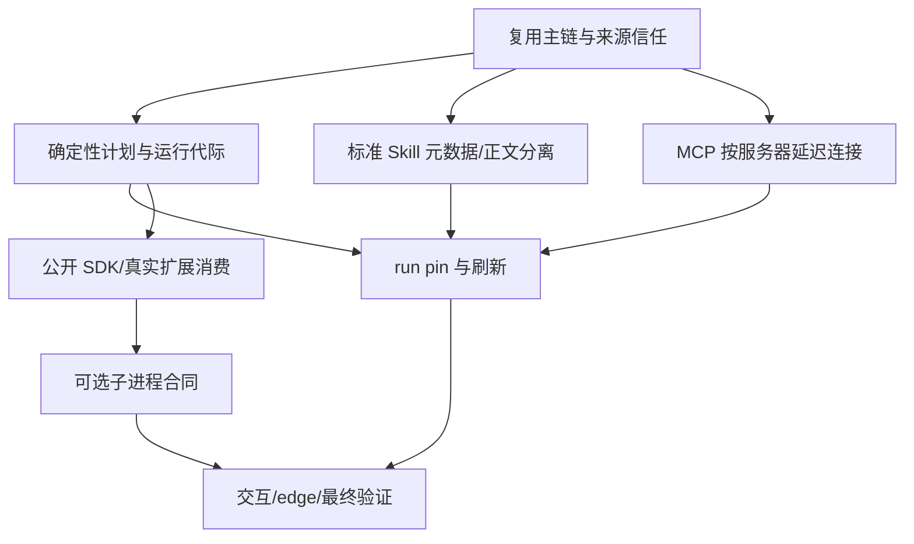

# Go CLI 动态能力演进路线

## Destination

把 10 月 18 日已研究但未生产接线的动态能力推荐实现为可运行、可交互、可验证的 go-cli 能力，并给出资源/体积的真实证据。规格正本是 [Go CLI 动态能力运行时](../../product/dynamic-capability-runtime.md)。

## Notes

- 使用 wayfinder → to-spec → to-tickets → codebase-design，Designer → Builder → Reviewer。规则输入为 go-cli AGENTS/CLAUDE、绝对路径 go-cli-infra 规范和 10/18 研究；仅独立 worktree 落盘。
- 用户授权自主决定本轮实现，疑问优先用源码对照、可执行实验解答，不能解答的放最终遗留；不做多轮访谈或重复审批。用户覆盖测试先行执行顺序：全部功能完成后统一验证。
- 规范适配：I_WORK_MATE Skill 是工作方式参考，不导入该仓库的 active 前置、文档目录形态或 TFS 目标。规格保持 review v0.1；这不是对正式评审状态的伪造。go-cli 无对应 TFS adapter，本地图/票据标 unpublished-to-tfs；以下 DAG 仅本地依赖，未创建 TFS PBI/Task 或原生关系。
- 禁止改 Makefile、CI、.golangci、infra rules/tasks/milestone。子代理不 commit；本地保存由主代理统一决定，不 push。
- 任一 quota 窗口剩余 <25% 立即暂停执行：保存成果、WIP/未完成与证据，由主代理统一归档、清理 worktree 和本轮测试数据。主代理周期检查并广播停工；子代理收到即停，不擅自删除或 commit。

## Decisions so far

- **复用现有运行主链**：typed Go 单体与现有 prepared dispatch/MCP owner，拒绝另建平行工具或会话系统。证据见 10/18 current-state/architecture。
- **标准 Skill 与元数据目录**：SKILL.md 是包入口，附属文件按需读取；兼容 legacy，不把目录中的所有 Markdown 当新 Skill。当前 loader 和 Assembly 源码证实这一缺口。
- **延迟 MCP 连接**：按服务器显式选择后 Connect/ListTools，复用 source generation 与 trust/approval。当前 deferred 仅延迟工具适配器，未降低冷启动连接成本。
- **代际与曝光分离**：generation 固定来源、配置和 owner；catalogRevision记录同代append-only MCP曝光，下一request才声明新schema。全局刷新等待idle。
- **有界 generation 生命周期**：current+candidate 或 current+retiring，单飞与 revision 防陈旧发布；run pin 和 completion fence 是真实消费要求，不以 atomic pointer 代替资源 owner。
- **默认 typed native、可选 subprocess**：公开 SDK 支持独立扩展；.so 不可热卸载；WASM 在无真实需求时不引新依赖。

## Decision DAG

决策细节与运行合同归规格；实现 frontier 见本地逐票据，避免图变第二份规格。

## Not yet specified

真实 edge 机器的设备型号、预算阈值与跨语言同语义性能目标；用本机基准和交叉构建给出有限结论，不虚构实机数据。平台 OS 沙箱如无实现，显式记录能力限制。

## Out of scope

修改保护规则和发布远端、付费模型 benchmark、没有需求支撑的 WASM 引擎、任意 Go 回调强杀与自动回滚外部副作用。
