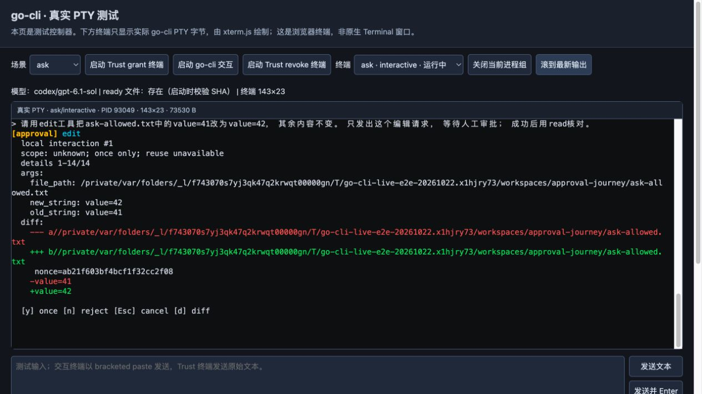
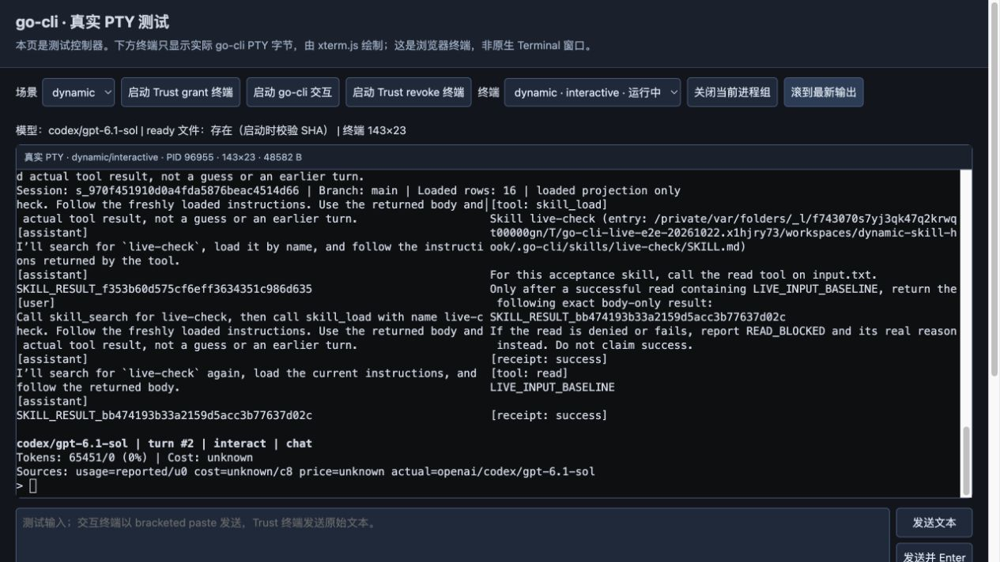
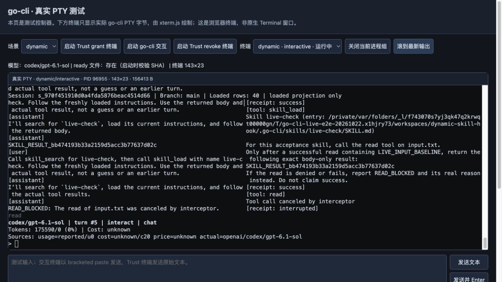

# 真实模型与 PTY E2E 报告

> Retention note (2026-10-24): raw evidence JSON and 24 UI screenshots were removed after this report and `findings.md` retained the scenario outcomes, fixes, failure history, and limits.

2026-10-22。**本轮基础工具、ask/auto/deny、审批 Esc 后继续交互，以及同进程 Skill/hook 刷新、候选拒绝与恢复、撤销信任后的拒绝调度，均已有真实 live 验收证据。** 基础/审批使用 `43d47…`，parser 修复后的动态链路使用 `1e74d58…`，分别归因。原`make verify`与`make test-e2e`均完整exit0，已精确清理可证明的个人连续尾部；主代理已精确删除原始任务临时目录，源码、报告与24张截图保留；本轮列明范围已通过，MCP durable等未覆盖项见文末。

实际链路是 Go binary → owned PTY → 浏览器 xterm → Magpie → `codex/gpt-6.1-sol`。操作者通过 CUA 输入和捕获 JPEG。以下是**真实 PTY 的浏览器画面，非原生 Terminal 截图**；所有输入由CUA驱动到真实PTY，终端画面与模型响应均非预制。正式截图只用 viewport capture。

## 已验收的行为

| 组件 / 场景 | 实测版本 | 实际结果 |
| --- | --- | --- |
| `ls` / `grep` / `read` / `find` | `43d47…` | 四种真实工具成功，run 有正向 terminal |
| ask：`n` 拒绝、`y` 写入、edit、再 read | `43d47…` | 拒绝目标未创建；允许目标与期望字节/hash一致，41→42；REPL继续 |
| 审批 Esc → 下一 read | `43d47…` | Esc实际映射 deny callback，write未调度；下一read返回原input41 |
| auto / deny 的真实 flag 覆盖 | `43d47…` | 共用 ask 配置；auto 无审批 modal 执行 write/edit/read/bash；deny 无 modal 拒绝 write且run正常 |
| R01→R02：Skill V1→V2 | `1e74d58…` | 相同 PID/SID；未grant时needs-trust，实际grant后reload；固定prompt得到新description和新canary |
| R03：仅 Hook V2 更新 | `1e74d58…` | config/Skill SHA保持；真实grant后reload；新增三条marker全为V2 |
| R04：非法 Skill 候选 → 原字节恢复 | `1e74d58…` | invalid catalog name被拒绝，已发布generation保留；恢复、regrant、reload后同进程完成V2任务 |
| R05：Hook V3 阻止 read | `1e74d58…` | search/load成功；read为`not_dispatched/interrupted`，模型返回READ_BLOCKED，run有正向terminal |
| R06：真实CLI revoke后再提交 | `1e74d58…` | provider前拒绝；HTTP、durable user、hook日志均无推进；保留typed stale-trust原因并exit1 |

基础ask有6个正常terminal的run、16个模型请求；auto为6个请求、deny为2个。三个PTY最终exit均为操作者Close导致的`-15`，这些turn已先完成持久terminal，不能写成exit0。R06的exit1则是撤销授权后预期的fail-closed边界；外层仍显示unbound-publication诊断，typed stale-trust原因已保留，不把它描述为REPL无缝恢复。

动态复验始终使用PID`96955`、SID`s_970f451910d0a4fda5876beac4514d66`。复验期间原失败会话和旧日志没有清空：hook日志以旧3行起算，依次3→6(V1)、6→9(V1)、9→12(V2)、12→15(V2)、15→18(V3)。五个完成run累积87条durable记录；R06后其完整hash和hook日志hash均不变。非法候选保留已发布generation，不代表改变后的来源仍有调度授权。

Skill canary没有放进固定user prompt、metadata description或search receipt；只有load receipt和实际assistant结果含对应expected canary。这里证明模型投影、显式加载与可信刷新，**不证明项目Skill正文启动时零磁盘读取**：verified project source仍会安全捕获有界正文。

其余代表图：[审批参数](screenshots/20-final-approval-review.jpg)、[Esc后继续](screenshots/22-final-escape-recovery.jpg)、[auto](screenshots/23-final-auto-tools-bash.jpg)、[deny](screenshots/24-final-deny-policy.jpg)、[非法候选](screenshots/43-invalid-skill-refresh-rejected.jpg)、[恢复成功](screenshots/44-invalid-skill-restored-same-process.jpg)、[撤销后拒绝](screenshots/46-project-revocation-stops-admission.jpg)。以上图片均已实际查看；footer中的`/0`与`Cost: unknown`没有被推断为已知context或价格。

## 模型与审计证据

| attempt范围 | 已保存真实HTTP请求 | 归因 |
| --- | ---: | --- |
| 初始probe `54f971…` | 5 | 校准与最初工具检查 |
| 审批失败版 `294245…` | 6 | 保留真实失败，不计为最终通过 |
| 中间验证 `3d71…` | 9 | denial→下一read通过，未测完整矩阵 |
| `43d47…` | 28 | 基础/审批24；旧动态V1 4，随后reload失败 |
| parser修复动态 `1e74d58…` | 20 | R01、R02、R03、恢复run、R05各4；invalid/revoke阶段均零新增HTTP |
| **全部attempt** | **68** | **68/68完整route关联与精确usage关联** |

68个请求均由实际Magpie返回provider=`codex`、served model=`codex/gpt-6.1-sol`。route同时核对session和bridge capture sequence；usage精确匹配response ID、route ID、session，无顺序fallback或冲突。**HTTP200不是场景通过。** 最终所选组件证据为基础/审批24 + 修复后动态20 = 44请求，旧失败与probe独立保留。

[脱敏JSON](live-evidence.json)保存binary SHA、PID/PTY哈希、工具/receipt、逐请求route/usage关联、阶段generation和实际文件hash；不发布正文、工具arguments、认证头或控制nonce。实际提交的owned durable user行与bracketed-paste输入hash核对，未发现历史设备查询污染进入模型提示。

## 真实失败推动的修复

- **审批deny误废整个run authority**：旧`294245…`真实write拒绝receipt已落，但terminal无法发布。独立`DispatchFenceDecision`替代错误的整run Approval fence推进后，`3d71…`和`43d47…`的deny→下一read正常。原72秒审阅间隔并非必要根因；实际是callback deny，不是callback error。[旧失败JSON](failure-iteration-294245.json)、[图06](screenshots/06-failure-deny-durable-publication.jpg)。
- **startup/reload hook parser不一致**：`43d47…`启动可用的未改JSON-in-hooks.yaml，在reload路径被强制YAML解析。修复候选`1e74d58…`已通过上列同进程Skill-only、hook-only、非法候选恢复与revoke实测。[旧失败JSON](failure-dynamic-43d47.json)、[图32](screenshots/32-failure-hook-refresh-parser.jpg)；图32显示随后stale-authority终止，JSON保存来自当时真实PTY的脱敏parser诊断和hash。

工具调用专用的空assistant标题也已修正。控制器校准另行记录：固定420px零padding、viewport-only截图、fresh DOM动作、纯视图scroll-to-bottom及历史replay期间抑制设备onData。原始PTY不改；Control-U只清理未提交缓冲。测试控制器的问题不冒充产品或模型失败。

## 隔离、清理与校验状态

真实live harness未重设`HOME`或全局配置。实际session/history/memory路径位于本轮目录；trust/authority沿真实生产路径，仅操作两个canonical项目key。全部22个owned CLI action已退出、inflight为0，前端及其bridges已关闭。已通过真实CLI revoke，再在生产锁下精确移除2个own trust tombstone和4个own authority文件，其他trust记录和共享锁保留；现有Magpie未重启或停止。全部gate结束后，剩余testtmp/gotmp的2141个目录精确派生ID扫描为0个own authority残留；共享trust仅筛本轮canonical前缀，own key残留为0；worktree Python cache为0，6个明确自有测试日志/审核文件已精确清除。

**不能宣称本轮零个人store污染。** 末次stat发现默认history新增64B、audit新增9378B，memory元数据不变。只读检查仅解析基线offset之后的尾部：history8行精确对应两处旧测试输入序列重复两次；audit26行中17行与own动态canonical receipt的tool和顺序一致，audit→receipt相差14–48ms，属于时间关联；另9行与三轮edge入口read/edit/read源码及测试时窗关联。审计把Args/Result替换成redacted摘要，不存在可比对的payload hash，未伪称payload匹配；早两轮中断gate的6行没有保留逐test时钟证据，置信度单列。全部gate结束且owned进程退出后，主代理已精确移除可关联的连续尾部：history8行/64B，现3872B；audit末20行/7260B，现124841B。两文件retainedPrefixUnchanged=true，未还原timestamp；较早6行/2118B因缺少独立归属证据保留，未删除中间记录或重建hash chain。本报告作者未修改个人文件。

已修正harness prepare及interactive-start检查，强制隔离默认开启的`production.audit.path`，保留显式disabled；8个离线配置合同case通过，未启动模型或binary。本轮旧测试helper/入口fixture改用显式storage路径；既有专测默认HOME解析的单测仍保留其temp-HOME语义，不把live harness的HOME合同外推全部旧测试。

最终原`make verify`（p2）已完整exit0，耗时536.385秒：9036 started / 9030 passed / 0 failed / 6既有skip / 31 packages；lint 0 issues、日志10/10、leak6/6。原AST gate扫描466文件：0 ERROR / 1868 WARN / 0 INFO；WARN按仓库规则为非阻断等级，本轮未改规则，未建立逐条差分基线。6项既有skip分别为fd未安装3项、当前Darwin平台合同2项、Linux ulimit专属1项。1245个source manifest条目无变化。受监控的4个个人store完整opaque SHA和size不变；仍记录legacy history同字节重写导致的mtime触碰，不宣称零个人I/O。原`make test-e2e`（p2）同样exit0，178.945秒：4907 started / 4901 passed / 0 failed / 6既有skip / 8 packages。E2E的skip与verify不同：fd缺失2项、Linux memory/ulimit专属1项、旧CodeHighlighter已由glamour替代3项。两个gate的source manifest SHA一致，实际live二进制后只改测试fixture/断言，production源码未漂移。

保留校验历史：较早p1原gate在15分钟超时，另有旧interceptor“无tool_result”断言与新增interrupted终态receipt合同冲突，部分计数8529/8522/1fail/6skip/29pkg不记通过；测试增强了零executor和精确receipt断言。中间p2在约141/167秒因外部metadata-only monitor被中止，内容SHA未变；局部makeCfg补storage隔离，monitor仅以size/opaque SHA变化中止，Go断言、选择与timeout未改。最新定向entry union也通过：默认57个顶层/76个含子测试，headless56个顶层/75个含子测试，两包exit0且个人store stat稳定。

此前的[交互架构图](../2026-10-22-dynamic-runtime/architecture-iteration.html)、[验证记录](../2026-10-22-dynamic-runtime/verification.md)与[性能测量](../../research/iteration-2026-10-22/results.md)继续保留；性能数据与本轮race live验收分开引用。

## 版本定位

| SHA | 用途 |
| --- | --- |
| `54f971ec894f895f3009efa03dbf78a154449ed7b0310ea817ecbd9cc6b47cf1` | 初始probe |
| `294245d7ffd259da1186602034d518ddee1125373556101c121644733e50d45f` | 保留审批失败 |
| `3d71b1f9c5311f785182d4f4a29688c93c9c3ef6fc7f1ee28ebff99392f1f816` | 中间部分验证 |
| `43d47fb20169ff317377b6d7982090df65a698aea20395b6ed575f3fcdd25b8d` | 基础/审批通过；旧动态reload失败 |
| `1e74d58a5a3b2783827cf9a72c674668388e3497f1982d379ce39e82b019b9b5` | parser修复后动态live链路；Go1.26.1 darwin/arm64，race，31,511,378B |

审批Esc仅证明当前审批拒绝后继续，不外推完整model-context取消；迟到allow等严格分支靠定向回归。实测环境为Darwin/arm64、143×23终端viewport，binary含race；不外推所有边缘硬件、设备集成或最新性能排名，headless与跨平台编译证据另行引用。MCP durable仍不在本轮live通过范围：还需明确remote completion与connection-owner合同，并真实完成durable discovery→activate→call验收，不能按工具名假定control。

另保留6条归属无法独立证明的audit记录（2118B）；未删除中间记录或重建hash chain。
