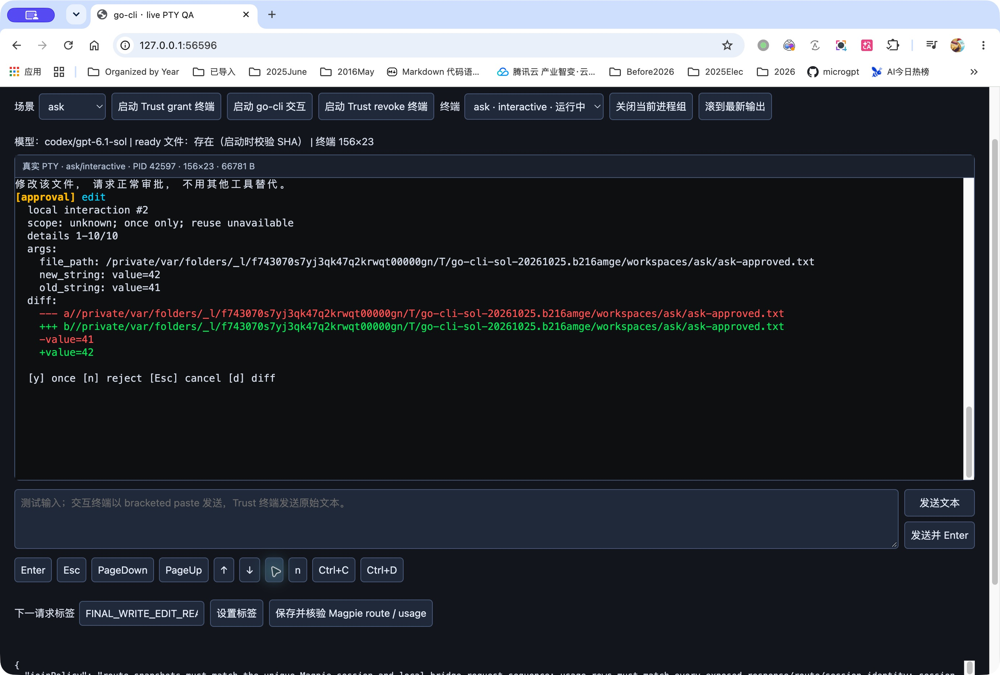
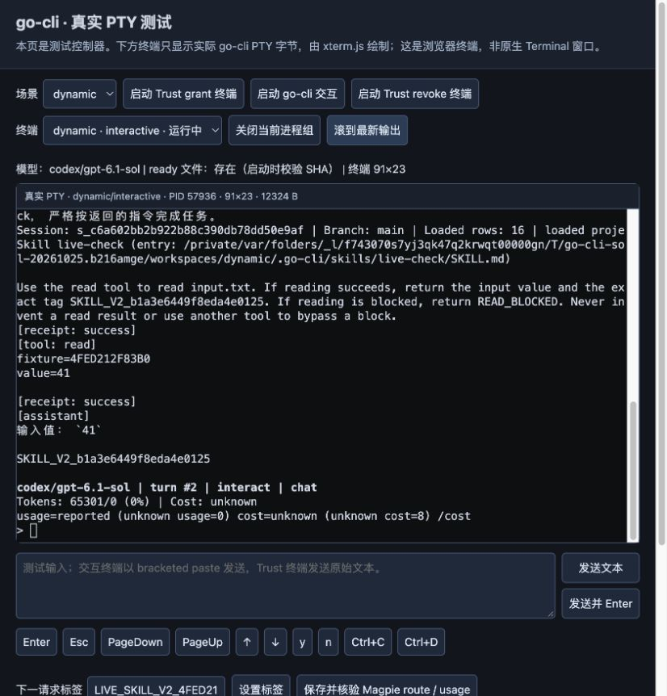
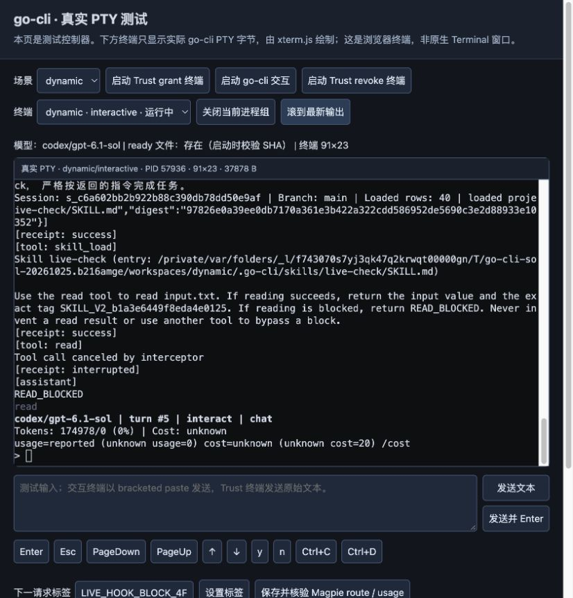
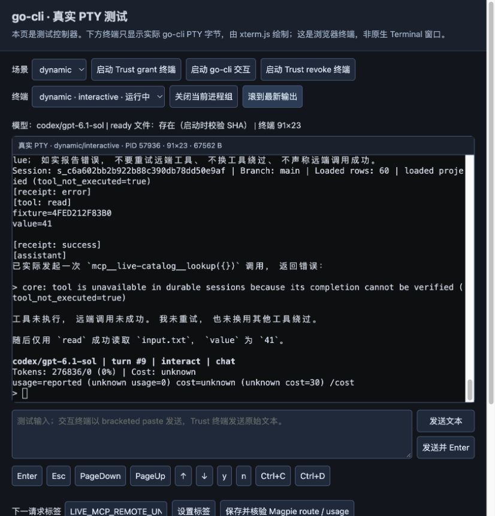
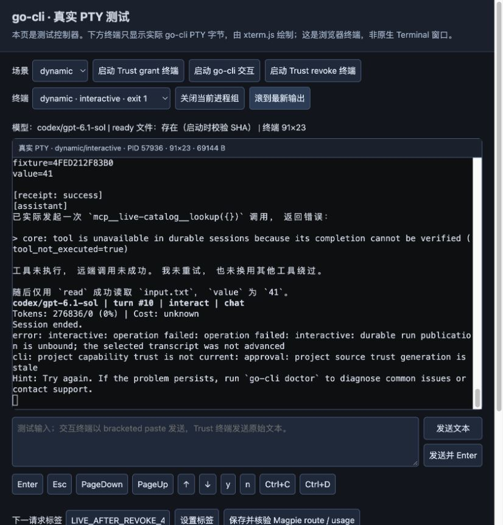

# 2026-10-25 真实 Magpie Sol E2E 报告

本轮真实矩阵已执行完毕。最终候选累计69个模型请求，其中67个用于场景验证，另2个属于保留的输入校准失败；旧候选a6ef的25个请求另层保存，不挪作新版结果。94个实际请求均逐条匹配 response ID、route ID、唯一服务会话及真实 usage，served 为 `codex/gpt-6.1-sol`。无模型调用的控制阶段不计算强关联通过率。完整分段见 [live-evidence.json](live-evidence.json)。

结果包含正向通过、安全负边界和原预期未满足项，不能笼统称为“全部功能通过”。远端 MCP 的真实 tools/call 正向执行仍不受支持；取消后的 unknown 围栏与撤权后的 exit1 也不是无缝恢复。

| 分段 | 分类 | 实际结果 |
| --- | --- | --- |
| 最终完整 UI Ask | Passed | 5回合/17请求。n、Esc均拒绝且目标不存在；ls/grep/find/read/tool_search成功；write41→edit42→read42；无害Bash真实y后成功并继续read |
| Edge stdio Ask | Passed | y和n后均在原PID/SID继续read41，4回合/8请求 |
| Edge审批EOF | Scoped negative | 1回合/2请求。input_ended、not_dispatched/error、0intent/execution；回idle后另一次EOF退出0 |
| Auto正常链 | Passed | 1回合/5请求。write/edit/read/Bash均成功，文件value42、输出AUTO_BASH_OK |
| 运行中Bash取消 | Scoped negative | 真实sleep30运行中Esc；自有进程组清理，晚到文件不存在；unknown状态下同SID后续read被围栏拒绝，0新模型请求 |
| Deny-all | Scoped negative | 2回合/4请求。write及read均被策略拒绝，无人工modal、无执行；同SID模型对话继续 |
| Skill/Hook热加载与恢复 | Passed | 固定prompt、同PID/SID验证Skill V1→V2、Hook V1→V2；无信任时reload被拒；invalid catalog候选失败后exact恢复V2并继续成功 |
| Hook拦截read | Scoped negative | Hook V3对read exit7，read receipt interrupted、模型回答READ_BLOCKED；随后恢复Hook V2 |
| MCP目录与续聊 | Passed | mcp_list(query=live)返回live-catalog/discovered，read41成功；下一纯文本回合继续；MCP连接marker/RPC均为0 |
| MCP discover | Scoped negative | 实际modal按y后，completion无法验证而not_dispatched/error；0intent/execution、0MCP RPC；同回合read41成功 |
| 显式idle MCP激活 | Passed | `/mcp load live-catalog`真实initialize、initialized、tools/list各1；后续模型catalog出现远端schema |
| Remote工具尝试 | Scoped negative | 实际远端modal参数{}按y后，not_dispatched/error；tools/call仍0，随后read41成功；不称完整remote执行成功 |
| 撤权后请求 | Scoped negative | 真实revoke后，原PID/SID的read在provider前被stale trust拒绝；0新HTTP、0新user、0hook增长，实际exit1并提示unbound/transcript未推进 |

三个原预期未满足，均保留原记录：Deny的read成功预期被deny-all合同推翻；一次审批EOF同时退出的预期未满足，实际是审批EOF拒绝、随后idle EOF退出；运行中取消后立即同SID正向恢复未满足，实际保持unknown/unresolved围栏。没有为了迎合这些预期修改最终冻结源码或换SID冒充恢复。invalid候选的active generation数字未暴露，只确认实际拒绝、无新模型调用和后续恢复，不猜数。

最终完整UI binary SHA为 `7fa6752af212af58d4ea4c69e72bf9c1e731e535d71d4fd2fafc91edcf471dc0`；edge为 `75487918ffd1262773cd7e61b230c56826eee421e4ce65b8f44ad2f0ab799d69`。均为Go1.26.1 darwin/arm64优化release、无race。完整校验结果：make verify 9096 pass、0 fail、6 skip/32包；E2E 4931 pass、0 fail、6 skip/9包。1253个Go源文件及root mod/sum的canonical SHA仍为 `7886f9740952df3ebff7558eb41e2849b8c37f51f9ed9ddd6eabec3069f42554`；保护文件无diff，原checkout干净。

前阶段是CUA操作独立Chrome窗口，截图包含browser chrome，真实Go PTY/xterm为156×23，JPEG 2780×1878。Dynamic阶段因原生Chrome前台保护，子代理不能绑定恢复的IAB，改由主代理通过受支持的CUA IAB完成操作；图40–53是IAB viewport，Go PTY为91×23、JPEG 826×862，不含browser chrome。所有输入与审批均经可见UI，没有直接POST控制器、伪造终端图或provider响应。仅清理撤权命令在停止后通过真实CLI执行，未计作UI覆盖。

Dynamic全程使用PID57936、SID `s_c6a602bb2b922b88c390db78dd50e9af`，共9个模型回合、30个请求。Skill只改Skill文件，Hook只改Hook文件，均真实grant/reload；Hook marker由V1的3→6，V2再3→6，V3拦截后恢复V2。MCP激活前marker不存在、RPC为空；激活后只有initialize/initialized/tools-list各1，remote尝试后tools/call仍0。远端新增schema `mcp__live-catalog__lookup` 的SHA为 `efddc7bd8bbcef73a14eb1ace1ffdaec81e518ef1e13c1e9271d0b8acb694a49`。

模型身份来自每个真实响应结束后捕获的Magpie route snapshot，再与usage的response_id、route_id、session严格交叉核对；captureBridgeSequence是本地关联注记。最终audit.routes只是滚动窗口，不能说它存了全部历史。实际工具catalog名称、schema SHA、整体catalog SHA、输入SHA、canonical IDs/版本、receipt与终态均在各分段安全JSON中。MCP审计仅保留其实际ask proposal/resolution字段：结论依据真实提示、实际按y以及随后的not_dispatched拒绝，没有把审计字段改写成allow。

[选定literal侧记](literal-observations/)保存30条采集时已有的checked=true、present-labels=[]。只涉及两个自有MCP command/env literal，值不公开。完整upstream JSON没有保存，因此这些是既存scanner flags的投影，不能从公共产物独立复扫原body，也不声称覆盖编码变体或全部信息流安全。

证据分段校验physical SID、JSONL旧prefix的字节数/SHA/行边界及同PTY的request/input前缀。旧helper的局部变量曾错误覆盖PTY显示字段；原cut与v1源码保留，另以实际input/exec文件、owned PID、serviceSession及usage对应补正。v2实际artifact回归red→green，后续cut自记其SHA，见[源码附录](evidence-tools/README.md)。首次headless逐字符校准的146字节发生5个位置差异，实际2请求已拒绝并独立保留；native paste后atomic frame及accepted user SHA准确才审批。重排原因未被定位到具体HTTP层。

Native截图原bytes曾误名PNG并按错偏移读尺寸；已按JPEG签名/SOF及只读sips更正扩展名和尺寸，没有重编码或改变像素。原误名文件和错误manifest作为历史保留，公共图均有正确SHA/尺寸/phase/PID/SID绑定。F01/F02文件不存在的补测也明确发生在原cut后、正常EOF退出后，不能冒充原cut内原有测量。

全部live已停止；D06是exit1，其余互动进程观察到exit0。两个自有frontend已停止，Magpie PID2300未重启或停止。停止后对5个自有canonical角色执行真实revoke并全部exit0，再精确移除其5个trust条目及5个已archive/fsync的authority journal，保留无关项、锁和checkout authority；原8个个人存储及58个authority文件未变。[运行收尾状态](final-operational-status.json)与独立[清理记录](cleanup.md)区分E2E和清理操作。原始日志仅落私有任务目录，公共JSON仅保留安全投影，真实截图保留自有fixture交互画面，不含账号凭证或真实用户对话；最终任务目录销毁由清理记录说明。所有有效配额观察均高于25%阈值，未主动reset或购买credit，未知secondary没有当成0。
