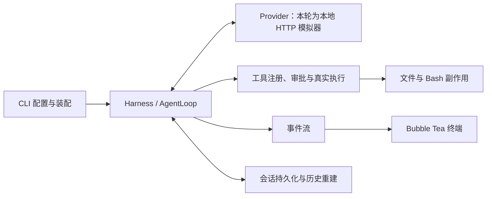
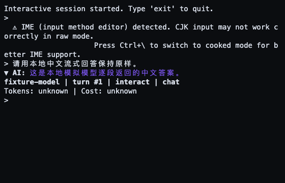
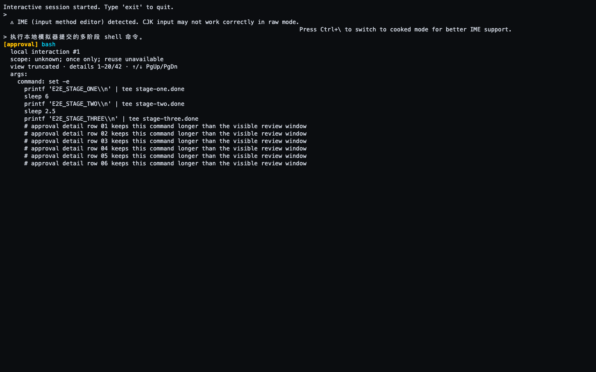
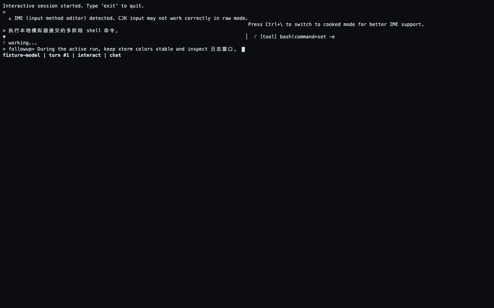
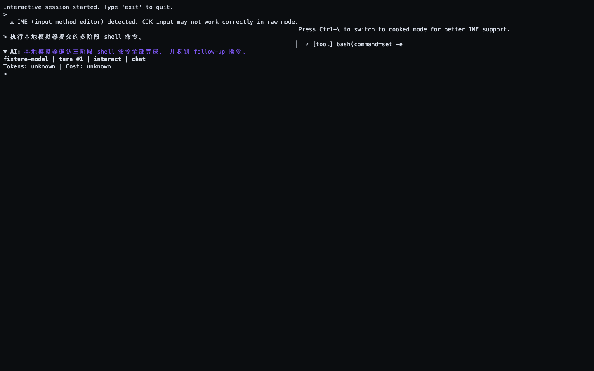

# Dot go-cli develop 端到端校验报告

日期：2026-10-14。执行：多个 GPT 6 Luna Max 子代理；主代理负责规划、证据审查、整合和回归门禁。

已修复运行中 follow-up 和 steering 输入丢失空格的问题，以及长任务按 Esc 后正常取消被误判为生命周期错误的问题。补齐真实 CLI 二进制、工具副作用、会话恢复和长任务验证。终端验收包含 36 项检查、12 张截图和 3 份原始 PTY 记录；最终全量回归结论见下文。

## 仓库与版本

本地仓库为 `/Users/yinyuepeng/projects/go-cli`。最初 checkout 是旧 feature 分支，远端缓存没有开发分支；通过 HTTPS 获取后定位了真正的 `develop`，初始比较点为 `e77e8058c51e5370a2ecc3eacb5fce0419829bcf`。

整合时检测到开发分支已有两个新提交，已保留它们并无冲突重放本轮修改：

| 版本 | 含义 |
| --- | --- |
| `e77e8058` | 初始审查和验证基线 |
| `1cd1951` | 上游修复：先发布 joined queue completion，再发布工具结果 |
| `4d1497b` | 上游修复：缩小 typos hex ignore 范围；最终整合的上游基线 |
| `2244627` | 本轮功能和测试修改整合后的源码提交 |
| `89df724` | Esc 取消生命周期修复；当前截图捕获的源码提交 |
| `6aa6f93` | 最终验收源码；只追加测试启动预算与工具进程组清理，产品源码与 `89df724` 相同 |

纯净初始基线的 `make test` 为 8,686 通过 / 3 失败 / 6 跳过，三个失败均为测试夹具，见 [baseline-e77-make-test.json](gates/baseline-e77-make-test.json)。初始基线加本轮 patch 的全量门禁记录保留在 [verify-e77.json](gates/verify-e77.json) 和 [test-e2e-e77.json](gates/test-e2e-e77.json)。最终整合源码 `6aa6f93` 的两套门禁均已通过，详见 [verify.json](gates/verify.json) 和 [test-e2e.json](gates/test-e2e.json)。

## 项目理解

Dot 是一个 Go Agent CLI：配置和 provider 适配由 CLI 装配到 Harness/Agent/AgentLoop；模型返回工具调用后，由工具注册、审批及执行层处理真实副作用；事件流驱动 Bubble Tea 终端视图，会话层保存并重建历史。验证分别观察用户界面、实际 HTTP 请求、工具结果、文件字节和进程生命周期，避免只验证模块 mock 的自洽性。

## 验收矩阵

| 场景 | 验证方式与关键断言 | 结果与证据 |
| --- | --- | --- |
| 启动、中文流式回答、窄屏 | 真实 binary + PTY + SSE；当前 viewport 的中文文本、终端尺寸和颜色 | 通过，[终端报告](terminal/evidence.md) |
| 审批分页、缩放、拒绝 | 长命令逐页浏览；审批出现前没有文件；拒绝回执送给模型；无副作用 | 通过，截图 04–07 |
| 允许执行、双栏、补充指令 | 三阶段真实 Bash 文件；运行中编辑器保留英文空格和中文；工具收据和 follow-up 原样进入请求 | 通过，截图 08–12 |
| read/write/edit/bash | 四种工具的 auto/deny；默认可信只读与非 TTY 写入拒绝；工具消息 ID 与实际文件字节 | 通过，[工具与审批证据](tools/approval-binary-e2e.md) |
| 工具错误恢复 | 首次 edit 失败返回给模型，修正调用实际改变文件 | 通过，同上 |
| 会话恢复 | 两次独立 binary 进程，第二次请求含原会话上下文及新输入 | 通过，同上 |
| 120 轮与压缩 | 120 个真实 SSE HTTP 请求；保留最新输入、移除最早历史；生产 compaction 日志 | 通过，[长任务证据](longtask/evidence.md) |
| follow-up 与长任务 | 等真实 Bash started 文件和生产 queue ACK 后释放任务；下一请求同时含完整指令和工具结果 | 通过，同上 |
| Esc 取消及继续使用 | 实际 PTY 按键；返回 interrupted；5 秒后仍无延迟写入，无自动续请求；随后新输入正常完成 | 通过，同上 |

## 发现与处理

| 类型 | 问题与处理 | 验证 |
| --- | --- | --- |
| 产品缺陷 | `f` follow-up 和 Tab steering 漏处理 `tea.KeySpace`，输入 `hello world` 变成 `helloworld`。两个编辑器按既有光标插入逻辑补空格处理。 | 先红后绿的 Update/View 回归；真实 PTY 的带空格请求；截图 11 |
| 产品缺陷 | 长 Bash 按 Esc 后，旧式 TUI 的 app-done 可能先于事件桥和 RunTurn 完成，被误判为提前退出。仅允许已请求取消的旧式 TUI 正常退出，仍等待任务及桥完成；未取消提前退出和 durable 刷新错误检查保留。 | 确定性生命周期红绿回归；真实 PTY 取消、延迟副作用与取消后新输入；完整 tagged 重跑 |
| 原有测试夹具 | ACP 只在读到握手后写 marker，1 秒等待无法区分未启动和未读到输入。补实际配置断言、启动/握手两阶段证据、有界等待，成功装配后立即登记清理。原失败阶段未被确定，不把它归因于主机负载。 | [ACP 红绿记录](tools/acp-trusted-executable-fixture.md) |
| 原有测试夹具 | Grep deadline 可能先于 escaped helper 启动。改为先确认真实 PID，再触发受控 DeadlineExceeded，保留未知副作用、错误链和停止断言。 | [长任务红绿记录](longtask/evidence.md) |
| 原有测试夹具 | gate 的冷启动预算和总体耗时上界不一致，500ms 期限又在全量 race 中早于 marker 创建。保留父退出、后代持管道的原场景，最终 2s timeout、3s WaitDelay、8s 外层预算，确认真实 PID 创建、124 超时和后代停止。 | 同上；模拟 peer 故意失败不等于真正验收门禁失败 |
| 原有测试夹具 | SSH 假执行器的 1 秒期限使个别本地退出被观察为 pending。夹具期限改为 5 秒，继续断言所有歧义状态及本地 quiescence。未修改生产 SSH 行为。 | 同上 |
| 验证装置 | 审批命令中的 marker 被误当作执行；截图文字读取包含历史滚屏；follow-up 编辑文本可见被误当作已入队；进程退出结果被重复消费后错误清理。分别改用真实文件、当前 viewport、生产 queue ACK、独立关闭信号。 | 真实 binary/PTY 重跑通过 |
| 验证装置 | 测试失败时只杀 CLI 进程组，可能遗留工具创建的独立 Bash 组。实际发现并确认早期失败用例的遗留组后清理；夹具新增自身 PID 文件和唯一 argv token，确认身份及组归属后才清理。 | 正确 token 清组、错误 token 保持运行的真实进程测试；完整长任务复跑 |
| 验证装置与文档 | 清除测试子进程继承的 NO_COLOR；使用系统临时目录；明确平台、sandbox 和捕获后元数据修订。原始字节流作为 binary 保存以保留控制字符和换行。 | [Standards 审查](standards-review.md) |

初次同机并行运行两套全量门禁时还观察到 core 并行身份持久化测试失败；随后目标 20 次、完整 tagged core 包均通过，未复现，未修改该功能。所有曾失败项和最终复跑分开记载，不能把定向通过代替全量通过。

最新上游整合后的首次完整 tagged 运行复现了 Esc 生命周期错误，原始失败摘要保留在 [test-e2e-224-cancel-red.json](gates/test-e2e-224-cancel-red.json)。独立审查还拒绝了额外的两秒退出兜底：该方案仅让等待函数返回，实际调用者仍需 join，不能宣称整体退出有界。最终修复保留原有资源等待契约。

夹具启动失败的中间门禁保留在 [verify-intermediate-startup-red.json](gates/verify-intermediate-startup-red.json)。该运行期间源码变化，旧记录器仅在结束时取 HEAD；摘要已标明它不是最终提交的验收。最终记录器同时记录开始版本与运行前后的源码差异哈希。

## 截图

图片来自真实 binary 的 PTY 原始字节，经 xterm.js 当前可见终端 viewport 渲染，由 headless Chrome 截取。每张的像素、PTY 行列、可见文字断言和来源在 [run-report.json](terminal/run-report.json) 中；它们不是文本生成图片，也不是原生 Terminal 窗口截图。

中文流式回答（64 列）：

长命令审批与分页：

运行中双栏和保留空格的补充指令：

执行完成：

其余截图按 01–12 编号保存在 [终端证据索引](terminal/evidence.md)。

## 回归门禁与限制

最终验收源码为 `6aa6f9318f3d3c40822c368e489c9284cd932072`。`make verify` 和完整 tagged E2E 均已通过，源码运行前后差异为空。

| 最终门禁 | 耗时 | 通过 / 失败 / 跳过 | 证据 |
| --- | --- | --- | --- |
| `make verify` | 370.378s | 8,707 / 0 / 6（28 packages） | [verify.json](gates/verify.json) |
| `make test-e2e` | 164.917s | 4,781 / 0 / 6（7 packages） | [test-e2e.json](gates/test-e2e.json) |

Verify 还包含 lint 0 issues、scanner ERROR=0 / WARN=1803、日志门禁 10/10、泄漏门禁 6/6。测试函数数量包含父测试和子测试，两组门禁有重叠，不能相加当作独立场景数。最终门禁记录开始与结束提交、源码差异哈希和完整日志哈希。

[acceptance.json](acceptance.json) 汇总源码、门禁与截图来源。已核对最终日志哈希、所有截图实际 PNG 尺寸、原始 PTY 字节数与哈希，以及截图后只有测试文件发生变化。

最终进程检查还确认并清理了两个早期失败用例遗留的旧 Bash 组；它们的命令均早于新增 PID/token 清理夹具。清理后未发现已知长任务夹具的 Bash leader，记录在 [fixture-cleanup.json](fixture-cleanup.json)。此检查不扩展为整机所有进程的证明。

- 执行平台为 macOS arm64。Linux 做了测试包交叉编译，未做 Linux 运行时或 Windows 验收。
- LLM provider 为确定性本地模拟器；验证的是真实 CLI、协议、工具和界面行为，未评价真实模型质量。
- 工具/长任务二进制用例的 Bash 使用 `--no-sandbox`；这些用例不验证 OS sandbox 隔离。终端截图脚本按普通交互装配运行，但同样不把截图当成 sandbox 安全证明。
- 中文通过脚本发送 UTF-8 字节；保留现有 raw-mode IME 提示，未验证真实输入法组合过程。
- 全量检查仍有明确的跳过项：fd 未安装、平台专属/反向分支、Linux OOM，以及被新 MarkdownRenderer 替代的旧高亮用例。源码扫描 WARN 保留，未作为错误清零或额外整改范围。
- 原始全量日志保留本地 `gates/*.log`，摘要、日志哈希和截图证据提交；原始流不改写内容。
- 最初纯净基线的 RTK tee 在 1 MiB 截断，不含最终统计；其数字来自当时命令返回结果，摘要已标明。后续门禁改用直接文件捕获，保留完整日志。

## 复跑与审查

从仓库根目录运行 `make verify` 与 `make test-e2e`。截图安装和运行步骤见 [terminal harness README](../../../scripts/e2e_terminal/README.md)。

### Standards

[独立审查报告](standards-review.md)：已解决可移植性与验证限制说明问题，无未解决的硬性规范问题；不把 lint 已检查规则重复列作人工发现。

### Spec

[独立审查报告](spec-review.md)：用户要求的终端、工具、长任务和截图均有对应真实证据，最新整合树全量门禁通过；未验证的能力不扩展为通过。
