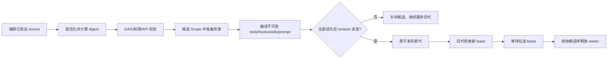
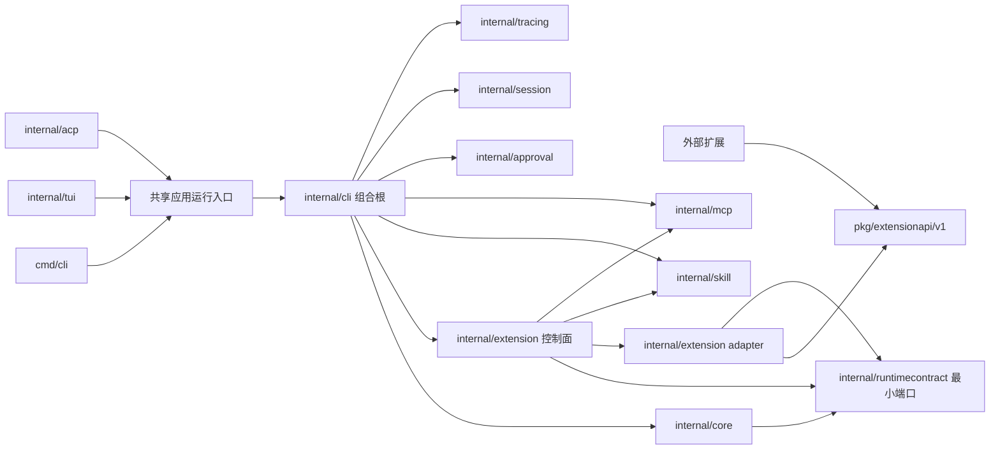

# go-cli 动态能力运行时目标架构

状态：Designer 提案，供 Builder PoC 与后续任务拆解。日期：2026-10-18。范围：动态 skills、MCP、hooks、prompt，以及扩展的 command/provider 投影；当前只新增研究文档，不改生产代码、保护文件或 CI。

## 设计目标

go-cli 已有可运行的 Agent 主链、MCP generation lease、extension owner/cleanup、skill load report、prompt cache、审批与 prepared dispatch fence。演进应复用这些合同，优先拆清组合边界和每次运行的能力版本，避免重写 3,496 行的 [assemble.go](../../../internal/cli/assemble.go) 或另造一套工具/会话系统。[当前审计](current-state.md)

目标是：配置与扩展更新经过校验后形成完整、可识别、可回退的 runtime generation；一次 turn 内所有工具、hooks、skills、MCP connection 与 prompt 都来自同一代；权限撤销能越过旧代立即生效；资源由明确 owner 持有并可有界关闭；稳定热路径不扫描文件、重建 registry 或动态解析图。外部插件有不依赖 `internal/` 包的公开 API，并明确声明同进程、子进程或可选 WASM 的信任和生命周期边界。

不承诺 Go 同进程任意代码可安全热卸载；不以 `atomic.Pointer` 本身当作资源生命周期；不把 MCP 的工具协议当作通用插件生命周期；不把 hash pin 当成来源认证；不在未测量前承诺 Go 接近 Rust。

## 关键现状约束

- 默认 skills 通过 `NewYAMLSkillLoader → definitions → deferred tools` 注入；`SkillRegistry.Match/List` 尚未进入默认 Assembly。下一阶段应让真实 CLI 消费 registry，而非另建 skill loader。[当前状态与源码路径](current-state.md#能力状态接入范围与缺口)
- extension 可以注册 tools、commands、providers、hooks 和 middleware，但 `PluginManager` 成功快照没有 commands/providers accessor，`assembleExtensions` 只投影 tools/hooks/middleware。command 在 CLI 路由前加载，provider 又需要在 model assembly 前接入；两者需显式安排加载时点，不能只加 getter。[Registry 与实际投影](../../../internal/extension/registry.go#L24) · [当前装配](../../../internal/cli/assemble.go#L1112)
- `.so` 是当前本机 Go 插件实现路径之一。Go 官方插件只能初始化一次，不能关闭；工具链/构建/依赖需匹配。它只提供同进程代码装载，不提供隔离或完整动态卸载。[Go plugin 官方限制](https://pkg.go.dev/plugin#hdr-Warnings)
- shell hook 的事件范围有限；在 prepared tool dispatch 下 `post_tool_use` 主动拒绝。此设计不扩张 hook 语义，先把现有 hook 接入顺序、scope、取消和失败合同做稳。[当前审计](current-state.md#能力状态接入范围与缺口)
- MCP 已经有按来源 stage/publish/retire、lease drain 与 setup 失败保留当前代的先例。只在其上抽可复用 lifecycle 合同，避免重复实现。[MCP generation 现状](current-state.md#能力状态接入范围与缺口)
- `AssembleAgent` 是组合根，`AgentAssembly.Registry` 是完成接线后的暴露对象，不是组装前工厂。第一步用窄的依赖合同注入构造点；先保持原 Assembly 顺序和默认值。[组合根现状](current-state.md#结论)

## 三种扩展执行位置

| 类型 | 放置 | 适用内容 | 信任与生命周期边界 |
|---|---|---|---|
| Native typed in-process | 静态编入 host 的 Go 函数与接口；配置只改变启用项和计划 | 内建 tools、core hooks、prompt compiler、受信任且与 host 同版本发布的能力 | 函数调用开销最低且共享类型，但 panic/崩溃影响 host；Go callback 只有合作式 context deadline，host 无法强制杀掉忽略 context 的 goroutine；不能卸载代码。不是不可信扩展沙箱。 |
| Subprocess RPC | 每个插件一个进程，经本地 gRPC/版本化 protocol 调用；管理器拥有 Runner、连接、启动与退出 | 第三方 Go 或跨语言 provider/command/长时工具；可接受 IPC/序列化 | 进程崩溃与 host 内存隔开，仍不自动限制文件、环境、网络、CPU/RSS 或系统调用。通过 OS 平台策略另施限制。MCP 可复用为 tool protocol，但扩展注册/manifest/生命周期另有协议。 |
| WASM（可选） | 当前不纳入必选实现；后续 ADR 比较裸 wazero 与 Extism ABI | 不可信但能力面小、需跨语言/便携的纯计算 hooks/变换 | guest linear memory、导入函数与 WASI capability 可限权；host functions 是应用权限面，需逐项审计。runtime 仍在 host 进程内；host funcs 可能阻塞或产生副作用。Memory pages 不是整个进程 RSS。 |

选择原则：内建热路径默认 typed Go；需要新代码与强故障边界时先评估 subprocess+OS 约束；只有出现跨语言能力/可移植 ABI 的真实需求后再评估 WASM。Hash、checksum 或 manifest digest 只锁定内容，不能证明发布者身份；远端 artifact 仍需来源签名和信任根策略。

## Runtime generation 与 owner

### 不可变快照

候选模型如下，名称是设计概念，不是现存 API：

```go
// SnapshotView exposes read-only accessors; mutable internals stay private.
type SnapshotView struct { data *snapshotData }

type SnapshotManager interface {
    Acquire(ctx context.Context) (GenerationLease, error)
    Rebuild(ctx context.Context, source CapturedSources) error
}

type GenerationLease interface {
    View() SnapshotView
    BeginCall(ctx context.Context, capability CapabilityID) (InvocationLease, error)
    Release()
}

type InvocationLease interface {
    View() SnapshotView
    Release()
}
```

`SnapshotView` 的所有导出访问器只能返回值或深拷贝，不得暴露共享 map/slice/pointer/function table 的可变引用；内部热路径通过包私有不可变计划避免每次 clone。每次工具/hook/provider 调用在 callback 前通过 `BeginCall` 取得独立 invocation ref，callback 完成、结果 fence 检查后才释放。父 run lease 释放会拒绝新调用，但已有 invocation ref 继续阻止 owner 关闭。

先由 `internal/cli` 作为组合根构建 snapshot，避免立即跨包搬动 assemble pipeline。被 `core` 使用的 lease interface 要最小化并依赖现有 core/tool 类型；是否增加独立 package 取决于实际 import graph，不能为抽象而制造循环依赖。

快照发布后不再修改其 slice/map/function table；对输入作 deep copy 或只保留私有构建结果。原子指针只承载完整快照。`Acquire` 需要与退休标志/refcount 在线性化协议上协作：竞态调用只能取得完整可用的旧代或新代，不能在旧 owner 已关闭后拿到 lease。该协议须用交错测试和 race detector 验证，不靠 atomic 指针单测推断。

### 候选更新事务



失败的候选从未可见；旧 generation 不变。每次 source/config 更新先在 manager 的短临界区递增单调 `desiredRevision`，candidate 捕获该 revision、trust epoch 与 policy epoch。所有重活在锁外构建；publish 在同一短临界区校验 candidate revision 仍等于 `desiredRevision` 且 epoch 未变，之后再交换 current 和标记 old-retiring。较新的更新先到时，慢完成的旧 candidate 必须返回 stale、清理自身 scope，不能覆盖新配置；内容 digest 识别相同内容，单调 revision 防止 ABA/乱序覆盖。publish 线性化点只做状态检查与引用切换，绝不在锁内调用扩展代码。发布后旧 generation 停止接新 run lease，但已有 run lease 仍可启动其子调用；每个在途调用由独立 invocation ref 保持 owner。排空超时后取消旧代合作式 context 并发出诊断；只对可强制终止的 subprocess/WASM 使用硬终止，绝不在活 lease/invocation 仍引用资源时提前 Dispose。旧 owner 清理失败则留在诊断表并阻止无界叠代更新。

### 所有权与复用

每个 candidate generation 有自己的 Scope/owner set：MCP 连接、subprocess、内建 extension disposer、WASM instance（若将来启用）、有状态的 hook/runtime pool 均登记其 owner。Scope 在调用 Setup 前先登记到 manager 的 candidate slot；Setup 半途失败也逆序清理已登记资源。Close 与 Release 的终结效果幂等；不持 manager/global lock 运行第三方 Init/Close callback；同一资源至多关闭一次。单个 finalizer panic 要被捕获为带 owner ID 的 cleanup error，仍继续运行其余逆序 finalizer，最终聚合诊断并关闭 Scope done 状态。Scope Close 的状态至少区分 open/closing/closed；若 finalizer 重入同一 Scope 的 Close，第二次调用必须立即返回 `ErrCloseInProgress`，不能等自己的 `done` 而死锁。需要等待关闭完成的 manager 通过独立 `WaitClosed(ctx)` 等待接口，并在 finalizer 执行路径外调用。终结错误需保留并关联 generation/owner ID。

允许跨 generation 复用的只限不可变编译制品、schema 或数据索引，且 cache key 需包含完整内容/依赖/编译器版本/相关 policy revision/共享范围/owner 与 source provenance。活跃连接、runtime instance、带状态闭包不得因 hash 相同而无条件共享；确需共享时定义独立 ref-counted resource owner，并测试最后一个引用释放才关闭。

配置重载单飞：任意时刻最多一个 candidate builder。candidate 构建期间到来的更高 revision 替换 pending revision；旧 builder 完成后在 publish 线性化点因 revision 过时被拒绝并清理，然后才启动最新 pending。资源上限按阶段定义：稳定状态只有一个 current；candidate 构建时最多是 current + candidate 两代；publish 后最多是 current + retiring 两代。retiring 未排空时不得再构建 candidate；后续 reload 只合并到最新 pending revision，等待旧代排空后再开始。candidate 构建失败要先释放自己的 scope。Manager.Close 先禁止新 build/publish，取消并等待已登记 candidate builder 与 owner cleanup；超时要返回 pending/stuck 诊断，不能在不可合作 builder 仍运行时报告关闭成功，也不能假称可强杀 in-process callback。诊断记录 current、candidate、retiring、pending revision 和未释放 owner，不能用永久后台 goroutine 静默重试。

普通 generation scope 不接管长寿命 SessionStore、数据库 schema 或进程级独占资源。SessionStore 等长期 owner 归 Assembly/进程持有，配置更新不能把它当普通插件关闭重建；schema 变更走可回滚迁移，采用 expand/contract 或显式维护窗口。若 candidate 必须绑定当前代已占用的端口、文件锁或唯一设备，须在 prepare 阶段 dry-validate 并标注 cutover：无法双开时执行有控制的停旧再启新，或返回 `restart-required`；不能承诺所有资源都能无缝双跑或在切换前完全 setup。

## 内容寻址、依赖图和确定性

### Generation ID

对规范化、版本化输入采用稳定编码和 SHA-256/Merkle digest。至少覆盖：有效 host config 与 source precedence；skill metadata 与正文；system/custom/append prompt 原文；hook declaration/ID/order/priority；tool 名称/schema/API version；MCP source、tool schema 与 server artifact/config revision；extension manifest/code digest；依赖图；feature flags；prompt renderer/tool converter 版本；权限策略 revision。项目来源继续基于 `LoadTrustedWithManager` 捕获的 verified bytes，不重新读未验证路径。[Project trust](../../../internal/config/project_trust.go#L13)

文件 mtime/size 只能用于发现文件变化的优化，不能证明内容没变。API key 等秘密不进入日志或可见 ID；generation 输入使用 secret handle/version。若必须 hash secret 值，digest 不对外暴露。Artifact checksum 和 source signature 分开建合同。

### 依赖 DAG

每个 node 有稳定 ID、owner、requires/provides、权限声明与生命周期 scope。发布前拒绝：缺 provider、重复 ID/provider 冲突、循环、版本不兼容、未授权 capability、项目来源未验证。排序先按依赖拓扑，再按 `phase → explicit priority → owner ID → node ID` 做稳定 tie-break。相同 source/config 在不同 map/并发注册顺序下必须生成相同 plans 与 ID。

依赖失效只重建依赖该 node 的候选子图；不过首版可以整体构建一个 generation。不要提前做细粒度增量更新，直到基准说明全图重建有问题。复用粒度不得跨越资源 owner/lifetime。

## Session / turn pin 与迟到写入

- **Pin 时点**：运行开始的准入成功后、首次 model/tool side effect 前取得 `GenerationLease`。lease 绑定 `runOwner`，直到 Agent goroutine、并行 tool calls、event producer 与 run commit 都 quiescent 才释放；等待者超时离开不代表执行资源已结束。现有 `RunSlotGuard`/`runOwner` 是挂载点。[run ownership 现状](current-state.md#主运行链)
- **Turn 固定**：一个 turn 的 tool definition、prepared tool dispatch、MCP clients、extension hooks、skill index 与 prompt builder 都由同一 pinned snapshot 提供。Candidate publish 只影响之后准入的新 turn，不在流式 model call 中切换。
- **迁移阶段与 pin 边界**：P0 保持现有 Assembly/REPL 行为，不开启 generation live reload；这只是兼容现状，不是目标 session pin。P5 完成 run-boundary 安全验收后才启用动态 adopt；每个 turn/run 在准入成功后固定要使用的 generation ID，并 acquire 对应资源 lease；Session 只保存项目身份和选择/信任元数据，不持有 generation resource lease。新代只供后续准入 run 选择；进行中的 run 继续使用自己的快照。配置选择（哪个 generation 给本 run）与资源 lease（保证所需 owner 活着）是两个概念。
- **Run lease 的完整寿命**：lease 绑定 `runOwner`，覆盖 Agent 执行、并行工具、子任务、event/stream producer、异步 commit 与所有 app-owned 写入；只有这些工作全部 quiescent 后才能 release。调用者停止等待、UI turn 结束或主 goroutine 返回不等于执行资源结束。等待者超时不提前释放 lease。
- **持久化与恢复**：每个已提交 turn 记录 generation/capability digest、实际 prompt digest 与 policy revision 以供审计和复现线索；resume 读取历史时按当前 config/skill/MCP/tool 可见性重新构造能力视图，并对每个操作按当前 policy 重新授权。历史 digest 不恢复旧权限，也不强制 session 永久使用旧 generation。trust 被撤销时，不等待下一代发布。
- **Late write fence**：所有 app-owned SessionStore、durable `RunCommitSink`、memory/todo/result 写入口携带 `runID + pinnedGenerationID + invocation epoch`。提交前验证该提交属于仍有效的 session 当前 run owner、generation 匹配该 run 入场时 pinned generation，且该 invocation 未取消/撤销；同时读取最新 policy/trust epoch。不得要求 `pinnedGenerationID == currentGenerationID`：合法旧 run 在 generation drain 期间可以完成并提交自己的结果。工具的 workspace mutation 在真正写文件前也经过已有 mutation/prepared dispatch policy。迟到输出不得覆盖已接管 session 的新 run 或提交到错误 generation。已开始的外部副作用不能因 fence 自动回滚，接口须返回“结果未知/部分副作用”而非伪造事务回滚。

OpenCode v2 提供了 generation 与 child Scope 的参照，但其数字 supervisor generation 只针对异步 update check 的陈旧回写；其 plugin update 先关闭/重建 scope 并可恢复旧闭包，不代表通用原子事务或所有在途 tool lease drain。以上 lease/drain/fence 是 go-cli 要额外建立和验收的合同，不能声称已被 OpenCode 证明。[OpenCode 项目比较](https://github.com/anomalyco/opencode/blob/4617210822bdbb31e5749751afbfb4584ccedac8/packages/core/src/plugin.ts#L90-L178) · [参考项目证据](reference-projects.md)

## 权限撤销与隔离现实

授权不保存在 generation 中作为永久许可。`PolicyStore` 是独立原子策略快照并有单调递增 epoch；revoke 发布新 epoch 是权限撤销的线性化点。此后新 invocation 必须被拒绝。通过授权并已取得 invocation token 的 callback 可能已经进入不可逆外部副作用；host 尽力取消合作式 context，并在 callback 完成、返回结果、发出后续 event 或 session commit 前重读最新 policy/trust epoch 与 run fence。即使 callback 忽略取消并返回 `nil`，旧 token 的迟到结果也必须被拒绝，外部副作用状态标记为 `unknown/partial`。这无法原子化 revoke 与任意插件 callback 内的副作用：policy check 后、实际写入前仍可能发生 TOCTOU。只有具体 mutation adapter 提供串行 admission/transactional commit 时，才可承诺 adapter 内“revoke 线性化后不再准入新 mutation”；不能把这一保证扩张到通用 callback。

权限逐层收紧：

1. 内建 Go 扩展只允许受信任的静态实现。context 只能约束合作代码；没有 goroutine、CPU 或内存硬隔离。
2. `.so` 与 host 共享地址空间和权限，加载它等同在 host 内运行同权限 Go 代码；digest pin 是完整性检查，不是沙箱或发布者认证。
3. RPC 进程只获得 SDK 定义的协议/capability，且用最小环境与工作目录启动；平台支持时以 OS user、job object、namespace/容器、文件路径/网络规则、CPU/RSS 限额配置。HashiCorp go-plugin 默认不提供这些资源限制。
4. MCP server 按现有 trust-source 与审批规则管理；不因其是 MCP 服务就授予 extension host 权限。
5. 若后续采用 WASM，默认禁用 WASI filesystem/network；逐个导入经审计的 host function。Go SDK Extism 是否线程安全、WASI 和每实例内存/超时均按 adoption gate 再验证。

## Skill、hook 与 prompt 的运行计划

- **Skill discovery**：candidate loader 聚合默认、用户、已验证项目来源，生成 SkillLoadReport 与内容 digest，然后冻结 `SkillIndex`。Assembly 创建 registry 并真实调用 `List/Match`：overview 只包含短描述；按用户 intent/hint 匹配时再暴露完整 skill tool，具体 progressive disclosure 以 Builder 合约为准。去重优先级/冲突行为明确记录来源，不读项目未验证路径。
- **Hooks**：只使用当前 core 支持的阶段和 adapter 能力。编译为不可变 HookPlan，顺序使用 `phase → priority → owner ID → hook ID`；相同输入、多次构建的执行序列一致。每个 callback 接收 child context、只读事件与受限 patch；检查取消和即时权限。错误策略按 hook 分类明确 fail-open/fail-closed，不因为“hook 失败”默认吞掉。PoC 的最终微基准统一记录在 [feasibility.md 结果表](feasibility.md#poc-结果)；后续先在真实 fixture profile，判断 per-call slice 或其它分配是否值得优化，不把 toy `allocs/op` 写成通用验收。
- **Prompt**：通过一个确定的 `PromptPlan` 排好来源与优先级：base/custom replace → tools/guidelines（tool name 排序）→ verified context files（source precedence 后按规范 path 排序）→ selected skills（match score 后以 skill ID 稳定 tie-break）→ memories（category/ID）→ cwd/date → append. 既有语义冲突要在设计期确认；同 ID 重复、append/replace 关系不能依赖 map 遍历。prompt digest 覆盖实际参与拼接的文本和 renderer revision，trace 记录 digest，不写秘密内容。
- **Skills 与 tools 一致**：prompt 宣称可用的 tool/skill 必须能经当前 generation 的 prepared dispatch 执行；撤销或 source trust 失败后不能只从 prompt 隐藏却仍可直接调用。

## 扩展 SDK 与可消费的注册

### 公开 API

对外 API 不能依赖 `internal/tools`、`internal/llm` 或 `internal/core`。proposal 是单独的公开 `pkg/extensionapi/v1` Go API 与 versioned wire schema（未来独立模块也可以），输入输出使用稳定 DTO：manifest、capability、tool schema/call、hook event/patch、command request/result、provider model/request/stream event、prompt contribution 与 diagnostics。每个 manifest 声明 extension ID/version、host API range、required/provided services、requested permissions、artifact digest、event budget 和 restart behavior。

公开 API 的 `Register`/`Init` 属于 host contract，不等于实现已消费。CLI 必须实际接上：command registration 在解析 CLI route 前建立 command index；provider 注册发生在 model resolver 选择和 `assembleModel` 前；tool/hook/middleware/skill/prompt 则投影到当前 Turn generation。所有投影做 duplicate/API/permission 校验，并在 init/assemble 失败时统一 rollback。

`.so` 如果继续加载，公开 package 解决 `internal` 可见性，却不解决 Go plugin ABI 与 unload 限制，仍需 host/SDK 的精确构建版本策略。RPC API 使用版本化 protobuf/gRPC 或等价 wire protocol；公开 Go SDK 只是便于客户端实现，不要求插件端是 Go。MCP 仍可作为 tool protocol 子合同。

### 初期外部 API 策略

第一步先定义公开 SDK/schema 和可消费能力矩阵，保持现有 `.so` 兼容路径并注明信任限制；之后按真实第三方用例实现 go-plugin/gRPC subprocess adapter。进程 RPC host 将启动超时、协议 handshake、artifact hash 和 `Runner` 接入点作为运行合同；来源签名与 OS sandbox 是单独 feature。WASM/Extism 延后到独立 ADR，不能与同一版本必选绑定。

### 目标包责任与依赖方向

以下是逐步演进的责任边界，不要求一次性搬迁 `assemble.go` 或新建所有目录。P1 仍先在现有组合根加一个 package-private factory seam；只有后续 consumer 真正需要时，才把控制面或 port 拆到新包。

| 包/边界 | 目标职责 | 不应承担的职责 |
|---|---|---|
| `cmd/cli`、TUI、ACP | 将交互输入转换为同一应用运行入口的 request/context；交互 transport 可不同 | 各自复制 generation、policy、plugin 装配与 commit fence |
| `internal/cli`（当前组合根） | 读取配置/受信任 source，创建候选能力计划，装配现有 core、skill、MCP、approval、session、tracing 组件并注入依赖 | 把 `AgentAssembly.Registry` 组装后替换当作前置 factory；把 source loader 放入 turn 热路径 |
| `internal/core` | 运行 Agent/turn；通过窄的 consumer-side runtime ports 使用冻结 capabilities、admission、权限检查和 run-owner 生命周期 | import CLI composition、extension runtime implementation 或外部 SDK 实现；执行文件扫描或动态 registry 构造 |
| `internal/extension`（后续可内部拆 control plane/adapter） | 管理 manifest/owner，捕获与校验 source，编译 DAG/digest，建 candidate、publish/drain；将公开 DTO 转成现有 capability adapter | 把 MCP message protocol 当作整个插件生命周期；把 `internal` 类型暴露给外部作者 |
| `internal/skill`、`internal/mcp` | skill source/index/report 与 MCP protocol/connection owner 的专业 adapter；按 generation 输入构建、由上层管理发布选择 | 在每次 dispatch 时重扫 source；单独拥有全局 generation 发布权 |
| `internal/approval` | 最新 policy/trust epoch 与 invocation authorization；撤权策略 | 把永久许可缓存到 generation lease |
| `internal/session` | 保存 run/generation/prompt/capability digest、run owner 与 commit fence 所需元数据 | 长寿 session 持有 generation resource lease；用历史权限恢复授权 |
| `internal/tracing` | 作为观测依赖记录 generation/run/invocation 关联信息 | 成为能力注册或授权的事实来源 |
| `pkg/extensionapi/v1` | 外部稳定 DTO、manifest、capability 与版本化 wire contract；兼容规则 | import 任意 `internal/...` 实现包 |
| `internal/runtimecontract`（仅在现有图需要防环时新增） | core consumer ports 与只读 runtime view 的最小 in-repo 合同；由 CLI 注入 adapter 实现 | 复制公开 SDK schema 或实现具体 extension loader |

目标依赖关系如下。`internal/runtimecontract` 是可选的最小端口 seam：若现有接口足够，不为图示而新增包。核心原则是接口由消费方定义或落在低层合同包，adapter 依赖合同，组合根依赖两侧并完成注入；core 不反向依赖 CLI/extension 实现，公开 SDK 不依赖任何 `internal` 包。



`共享应用运行入口` 是行为要求，不要求立即新建 `internal/app`：当前可让 TUI/ACP/CLI 复用同一现有 run service，再通过小 PR 渐进抽出 facade。每个接线 PR 都应验证 CLI、TUI、ACP 进入相同 run admission、policy check、generation pin 与 commit path，不出现两套 assembly。

## 资源与性能预算（提案）

| 范围 | 初始 proposal / 验收目标 | 说明 |
|---|---|---|
| Published generations | 1 current + 至多 1 draining；reload 单飞，待处理 config 合并到最新 revision | 防止慢插件让旧代数量与 Scope 数无界增长；drain 卡住则保留诊断并限流更新。 |
| Warm hot path | 先按同一 PoC 与生产 fixture 记录 `ns/op`、`B/op`、`allocs/op`；lease 与 hook 的分配优化是 profile 驱动项，不预设尚未达到的 0 alloc 门槛 | 最终有效 PoC 数值只见 [feasibility.md 的结果表](feasibility.md#poc-结果)；该临时模型不是生产 SLO、不是全 turn 数据，也不能单独推出 Rust 性能。 |
| Extension concurrency | 每 owner 有有界 semaphore，提案默认 `min(8, GOMAXPROCS)`；可按 plugin class 限制，超限等待必须响应 context 或返回 overload | 数值是待 Builder 在真实 tool/MCP fixture 验证的 provisional default；不让配置出无界队列。 |
| Stream / result bytes | 有界的 in-flight 数和累计 queued bytes；以现有 tool output guards 作为上限基础。新 RPC stream 按 frame 和 overhead 同时计费；不只数 payload。 | 具体字节阈值按 current tool/result 数据分布测量后写入配置，PoC 用小参数证明边界行为。 |
| Generation overlap | 稳态 1 代；build 阶段最多 current + candidate=2；publish 后最多 current + retiring=2。retiring 未排空时不建下一 candidate，仅合并最新 pending revision | 明确涵盖 candidate；防止更新风暴出现三代运行时/多个编译池。 |
| Cleanup | 每 owner 幂等 close；所有可取消工作响应上下文；`Assembly.Close`/manager shutdown 有 deadline 且记录超时 owner。稳定测试关闭后无新增 goroutine | 对忽略 context 的 in-process callback 只能报告挂起，不能谎称已硬停止。 |
| WASM | 若未来启用，每插件实例有 manifest memory pages、实例数、调用超时、输入输出字节限制，并计入 compile cache 生命周期 | 非整个进程 RSS 上限；先走 adoption gate。 |
| Process plugins | 如平台支持，配置 process memory/CPU/file/network 限额；统一启动/退出/握手/调用队列上限 | subprocess 本身不自动获得资源限制；不同 OS 的能力须分开报告。 |

最终有效 PoC 数值只在 [feasibility.md 的结果表](feasibility.md#poc-结果) 维护，避免在架构和计划文档复制可能被 Reviewer 修复改变的结果。该临时模型不是生产 baseline/SLO，也不构成同平台 Rust 对照。后续先在真实 fixture 建基线，再决定是否把 lease/HookPlan 的分配减少作为优化；不得把 0 alloc 或 toy 纳秒值写成当前保证。正式比较固定相同功能、输入/输出大小、并发度、build flags、Go/Rust toolchain、OS/CPU，分开冷启动、稳态、reload、drain、failure；同一 fixture 用 fake LLM/MCP 剥离供应商网络延迟。

若要用“接近 Rust”作为决策目标，基准必须分别给出 `CPU_Go/CPU_Rust`、`throughput_Rust/throughput_Go`、`p95_Go/p95_Rust`、`RSS_Go/RSS_Rust`。先采集代表性 go-cli workload 的 Go baseline，再由维护者按产品约束在对照实验前确定每个 ratio 的目标区间；当前不预置数字，也不允许用 lease atomic load、空 hook 或单一吞吐指标代替完整结果。超过任一目标时，按 CPU、吞吐、尾延迟或内存瓶颈分别决定优化，报告原始样本与不确定性。[当前基准与宿主信息](current-state.md#性能热点与基础验证清单)

## 失败策略

| 故障 | 处理合同 |
|---|---|
| parse、API version、DAG、permission 验证失败 | 拒绝候选，不改变 current；返回具 owner/node/source 的诊断，不泄露 secret。 |
| 候选 Init/compile 部分失败 | 清理候选中已登记资源；保留旧 generation；任何 command/tool/provider/hook 注册都不对外可见。 |
| prompt/hook/tool projection 冲突 | 默认拒绝 candidate，不能静默忽略部分组件导致模型能力与执行器不一致。只有产品声明 optional extension capability 时才允许可观测地降级。 |
| 运行 hook/tool 返回错误 | 按不同类别的明确 policy 回报；涉及审批/安全/写副作用的路径 fail closed。完成的外部副作用如实报告。 |
| owner Close 超时/失败 | 旧代标记 cleanup pending，保留可诊断的资源记录；不重试非幂等 cleanup，限制下轮 generation build，保持 current 可用。 |
| permission revoke | 更新独立 policy epoch 并取消对应调用；commit fence 拒绝迟到写。无法撤回已提交给外部系统的副作用。 |
| process plugin 崩溃/协议不匹配 | 熔断该 owner、丢弃队列、标记调用结果确定/未知、禁止半连接继续执行；candidate 失败回退旧代。 |

## 被否决或延后的设计

- **把原子指针直接称为 live reload**：无 refcount/drain 不知道哪些旧闭包仍在使用资源。
- **用 mtime/size 作为内容 identity**：不能捕获保留时间与大小的修改，也没有把依赖/权限变化纳入 key。
- **继续以 Go `.so` 作所有动态代码路径**：不可卸载，不跨工具链稳定，不隔离。
- **大一统 `PluginContext` 可以 import 全部内部包**：让 SDK 随内部实现漂移，过度授予 host 权限。
- **每 turn 重建整个 loader/registry**：不必要冷启动和分配；先在候选控制面 build/reuse immutable artifacts。
- **同一代内对 hooks 和 prompts 使用 map 顺序**：不可重复、不可审计。
- **无界 drain/retry/goroutine**：资源无法给出上界。
- **本次直接引入 Extism/WASM**：没有当前真实用例和 adoption 数据；留 ADR 评估。

## 参考

- [当前架构状态](current-state.md)
- [参考项目源码证据](reference-projects.md)
- [用户提供的原始项目比较输入](/Users/yinyuepeng/projects/dji-tone-studio/docs/research/agent-architecture-2026-10-18/comparison.md)
- [OpenCode v2 参考项目源码](https://github.com/anomalyco/opencode/tree/4617210822bdbb31e5749751afbfb4584ccedac8)
