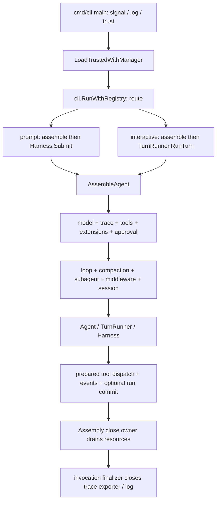

# go-cli 当前架构状态与演进切入点

审计基线：`9046ec3246fa89c69bbdd0dcb150672d85b0c5a2`（`dev`，与 `origin/develop` 对齐）。
环境：Go 1.26.1、darwin/arm64、Apple M1、16 GiB。当前报告基于源码和已有设计文档检查；本阶段未运行测试、构建或性能基准。工作树生产代码未改。

## 结论

go-cli 已经是有真实运行链和多项资源/安全合同的 Go Agent 框架，不是等待补齐的空骨架。CLI 主路径贯通了 provider、prepared tool dispatch、审批、事件、可选持久化、追踪和资源关闭。近期代码也已实现 MCP generation、插件 tool projection 失败关闭、skill 加载汇总等能力。不要重造这些组件，也不要仅凭源文件数量推断可扩展性。

当前最具体的架构负担是组合根过重：[`internal/cli/assemble.go`](../../../internal/cli/assemble.go#L393) 有 3,496 行，把 CLI 模型解析、MCP/skill/extension 投影、工具与审批管线、resilience、session、prompt 和关闭资源集中在同一 `assembleState` 上。`AgentAssembly.Registry` 暴露可替换的接口槽位，但它是在默认组件已经建好并接线后返回；它本身不是一个组装前的工厂/依赖注入入口（[`AgentAssembly` 的构造与返回](../../../internal/cli/assemble.go#L456)）。

因此建议先抽清“可扩展的 composition contract”与“一个 run 的生命周期合同”，沿着现有 `AssembleAgent`、`RunSlotGuard`、MCP generation 和 durable run commit 逐步演进。首轮不要做全量架构重写。现阶段没有本机 Rust 编译器，也没有同工作量的 Rust 对照基准，不能据此声称 Go 已接近 Rust；先用固定工作负载量出 CPU、分配、堆占用和延迟，再决定是否需要改热点实现。

## 主运行链

1. [`cmd/cli/main.go`](../../../cmd/cli/main.go#L77) installs a canceling signal context, redirects redacted slog output, registers commands and loads trusted config. Config loading captures project sources and only merges a project overlay after the trust manager verifies the captured manifest ([`config/project_trust.go`](../../../internal/config/project_trust.go#L13)).
2. [`cli.RunWithRegistry`](../../../internal/cli/cli.go#L180) parses global flags and selects a registered command. `prompt` assembles once, submits through `Harness`, consumes the event stream, then closes Assembly ([`prompt.go`](../../../internal/cli/prompt.go#L200)); interactive mode creates one Assembly and drives turns through `TurnRunner` and the TUI ([`repl_session.go`](../../../internal/cli/repl_session.go#L319), [`executeTurn`](../../../internal/cli/repl_session.go#L757)). These are two entry adapters over shared components, with distinct result/rendering orchestration.
3. [`AssembleAgent`](../../../internal/cli/assemble.go#L393) orders model, trace, tools, extensions, approval, resilience, output guards, extra tools, loop, compactor, subagent, middleware, and session setup. The `assembleState` owns construction temporaries and an `assemblyCloseOwner`; failed assembly enters the same cleanup path ([`newAssembleState`](../../../internal/cli/assemble.go#L570), [`runCleanup`](../../../internal/cli/assemble.go#L785)).
4. The runtime has meaningful run admission and shutdown ownership: `Harness.Submit` and `TurnRunner.RunTurn` claim a `RunSlotGuard` before borrowing tracing or invoking callbacks; a `runOwner` retains the claim until execution resources finish ([`harness.go`](../../../internal/core/harness.go#L148), [`turnrunner.go`](../../../internal/core/turnrunner.go#L83)). The durable CLI path can bind a run-commit sink and hydrate history before execution ([`durable_cli_session.go`](../../../internal/cli/durable_cli_session.go#L165), [`prompt.go`](../../../internal/cli/prompt.go#L249)).

## 能力状态：接入范围与缺口

| 子系统 | 当前真实状态 | 边界和证据 |
|---|---|---|
| Config / trust | 生效中的配置顺序是 Default → File → Env → Flag → Override；CLI 的 trusted loader 另外捕获 project source，并在验过 snapshot 后合入 project overlay。 | [`loader.go`](../../../internal/config/loader.go#L32)；[`LoadTrustedWithManager`](../../../internal/config/project_trust.go#L13)。验证后继续使用 captured bytes 的路径已存在，定制 loader 不应绕过该 capability。 |
| Model | CLI 有自己的 model resolver；Assembly 根据配置构造和装饰模型，配置的 timeout、retry、circuit breaker、cost 与 model selection 由组装顺序串接。 | [`assembleModel`](../../../internal/cli/assemble.go#L794)；[`cliModelResolver`](../../../internal/cli/assemble.go#L1950)。不要把声明存在的每个 Provider API 都当作 CLI 可选择的 provider。 |
| Tools / approval | builtin、custom command、MCP、LSP、remote bash 与 skills 注册到 deferred tool registry；之后将 prepared dispatch fence、审批策略、mutation queue 装入 middleware registry。 | [`assembleTools`](../../../internal/cli/assemble.go#L953)；[`assembleApproval`](../../../internal/cli/assemble.go#L1255)。注册表与 invocation pipeline 已接通，后续 extension 应保留项目来源绑定和 dispatch lease。 |
| Extension | 支持构建环境可用时加载本地 Go `.so`；插件初始化阶段暂存注册项，再映射工具、hook 和 middleware。当前 Assembly 对 extension tool projection 失败会返回错误并统一清理。 | [`plugin.go`](../../../internal/extension/plugin.go#L26)、[`assembleExtensions`](../../../internal/cli/assemble.go#L1112)。HTTP(S) 与 gRPC 被明确拒绝；这不是可用的远端插件 runtime。Go plugin 是同进程代码，不提供隔离或热卸载。 |
| Extension 未接能力 | `ExtensionRegistry` 接受命令和模型 provider 注册，但 `PluginManager` 没有对应完成快照 accessor，默认 `assembleExtensions` 只投影工具、hooks、middleware。因此命令/provider 扩展当前不参与默认 CLI 命令路由或 model resolver。 | 接口定义 [`extension/registry.go`](../../../internal/extension/registry.go#L24)，实际投影 [`assemble.go`](../../../internal/cli/assemble.go#L1145)。这是值得明确声明/实施的能力缺口，不能先把注册成功说成已运行。 |
| Hooks | HookChain 对每轮 before/after 调用扩展 hook；项目 shell hooks 从 verified source bytes 解析。Hook DTO 快照有 clone/预算边界。 | [`assembleExtensions`](../../../internal/cli/assemble.go#L1164)；[`loadConfiguredShellHooks`](../../../internal/cli/assemble.go#L1183)；[`extension_hook_snapshot.go`](../../../internal/cli/extension_hook_snapshot.go#L68)。shell hook 的 `post_tool_use` 在 prepared execution 下主动拒绝 Assembly；其他执行事件按 core HookSystem 支持集限制，不能视作任意生命周期 Hook API。 |
| Skills | Assembly 通过 YAML loader 解析 skill，并以 deferred tool 暴露；description/category 加进 system prompt。当前版本有 loaded/skipped 汇总和逐文件固定类别日志，project skill 从已验证的 captured sources 读取。 | [`registerSkillTools`](../../../internal/cli/assemble.go#L2663)、[`loadVerifiedProjectSkills`](../../../internal/cli/assemble.go#L2849)。`SkillRegistry.Match/List` 与 process registry 是库能力；default Assembly 直接创建 YAML loader，没有使用 skill registry 的 Match/List 路径（[`skill_registry.go`](../../../internal/skill/skill_registry.go#L14)、[`skill/registry.go`](../../../internal/skill/registry.go#L20)）。 |
| MCP | 传输 client、tools adapter、source selection、按来源构建 generation、hot reload 和 Assembly resource owner 都有实现。候选生成完整后发布；generation lease 退休后等待执行结束再 disconnect，候选失败不会先关掉当前 generation。 | [`mcp_generation.go`](../../../internal/cli/mcp_generation.go#L19)、[`mcp_generation_owner.go`](../../../internal/cli/mcp_generation_owner.go#L53)、[`mcp_generation_owner.go`](../../../internal/cli/mcp_generation_owner.go#L166)。这些已有协议是全 Assembly 原子换代的可复用先例；尚不能泛化成整个 Assembly 的 live reload。 |
| Prompt / context | `SystemPromptBuilder` 可替换；默认 builder 按全部输入求摘要并缓存完整 prompt。CLI 为 tools、context files、skills、memories、custom/append prompt 等组装输入。 | [`system_prompt.go`](../../../internal/core/system_prompt.go#L92)、[`Build`](../../../internal/core/system_prompt.go#L175)。缓存计算和 prompt 构造是可用的 profiling 点；当前内容随工具/skill 数和历史输入变化，不应无测量地增加缓存层。 |
| Session | `SessionStore`、树、JSONL、durable writer、action intent/receipt、恢复和 reconciliation 均存在。持久化取决于配置的 `session.store_path`；durable run commit 是显式路径，普通 prompt/interactive 也有非 durable 或内存/无 store 情况。 | [`assembleSession`](../../../internal/cli/assemble.go#L1936)、[`prompt.go`](../../../internal/cli/prompt.go#L204)、[`durable_jsonl.go`](../../../internal/session/durable_jsonl.go#L69)、[`run_commit.go`](../../../internal/core/run_commit.go#L128)。注意不要把 session tree 存在说成所有默认运行都会 durable。 |
| Tracing | CLI invocation 创建一个 tracer；默认 exporter 为 redacted async JSONL，stdout/no-op 可选。Assembly 从 context 复用 tracer；async exporter 有界队列、批量 worker、队列满计数和关闭预算。 | [`newTracing`](../../../cmd/cli/main.go#L533)、[`BuildTracingRuntime`](../../../internal/tracing/runtime.go#L46)、[`AsyncExporter`](../../../internal/tracing/async.go#L65)。runtime 当前只允许 jsonl/stdout/none；OTLP/Kafka 有构造/适配代码不等于默认 runtime 可用或已通过外部 wire 互通。 |

## 旧审计和设计材料需要重验

`docs/audits/2026-09-24` 的审计基线是 `40692e35`；它提出的多项 P1 已由后续运行时迭代处理，不能照搬到本基线。例如 current source 中有 stream/run ownership、durable run commit、MCP retired generation leases 和 output/approval prepared dispatch。每个旧缺陷仍需按当前源码与当前测试判断；旧复现日志仅证明旧基线。

`docs/iterations/2026-09-30-runtime/r7-runtime-capability-disposition.md` 标注的源码快照是 10 月初旧版本，其 §20/23 关于“Skill 无结构化加载报告”和 §26 关于“extension tool 注册失败 warning-and-continue”已经过时：当前 [`registerSkillTools`](../../../internal/cli/assemble.go#L2675) 生成 load report，当前 [`assembleExtensions`](../../../internal/cli/assemble.go#L1145) 对失败执行 fail-assembly。该文档仍可用于识别未接的 skill progressive discovery、extension command/provider；不要复用其旧行号与 disposition 作为当前结论。

同样，9/30 设计材料里建议的 MCP generation、extension tool owner/failure 和 skill load report 部分已落进源代码。后续 Builder 任务应先对照当前定义/测试，避免重复实现或将旧 handoff 当作现行决策。

## 最小演进切入点

1. **先为组合根立接口，不先移动大量文件。** 从 `AssembleAgent` 中提取一个小型 Assembly dependency/factory contract，只把现有硬编码构造点（模型 resolver、provider、tool registry、skill loader、plugin loader、tracer、session opener）变为可替换的 dependency。首个验收保持默认 Assembly 字段和顺序不变，且通过一份 fake provider + fake tool 的端到端 mock 测试。避免把 `Registry` 的 late replacement 当成预接线能力。
2. **把共享的 run ownership 定为唯一生命周期事实源。** `Harness` 与 `TurnRunner` 是两种入口，但都需要 admission、run identity、cancel→drain→quiescent/unknown、结果提交与关闭隔离。优先定义/验证一个薄的 run coordination contract，再逐步让两个入口复用。不得把“调用者取消等待”当作执行完成；采用现有 `RunSlotGuard` 和 MCP prepared dispatch leases，逐个验证阻塞 callback、并行工具和 close waiter 超时。
3. **扩展接口先做“可发现且可消费”。** 为 Extension command/provider 建立清楚决策：实现默认 CLI 的路由/resolver projection，或将当前 API 明确标成 library-only。只增加 register/storage 接口而不让 consumer 读取，不能算可定制能力。对于 project extension hook/middleware 还要明确 revoke/live generation 生命周期，不借用 project tool 的 revocation 保证。
4. **只在需求要求动态配置时推广 generation swap。** MCP generation 已展示 stage → validate → publish → retire → lease drain。若扩到全 Assembly，先冻结有效 config/source manifest，构建 candidate 所有组件，校验全部通过后一次性发布 generation；失败保持旧 generation 可用，并由 owner 负责候选 cleanup。native Go `.so` 本身不可卸载，因此插件更新需要 restart 或隔离进程方案，不要承诺进程内热替换。
5. **性能预算来自 benchmark/profile。** 先建立稳定的 mock 工作量（比如固定 prompt 字节、N 条 history、N 个工具、固定事件数）并复用现有测试 server；报告 `ns/op`、`B/op`、`allocs/op`、峰值堆、goroutine 数和 p50/p95 延迟。Go 与 Rust 对比必须使用相同输入、协议、并发度和语义；没有这样的实测，就只报告 Go 内部变化。

## 性能热点与基础验证清单

仓库已有基准入口：`BenchmarkLoopRun`/`BenchmarkAgentRun`/`BenchmarkBuildToolDefinitions`/`BenchmarkEventStreamPushPop`/`BenchmarkEventStreamConcurrentSend`（[`core/bench_test.go`](../../../internal/core/bench_test.go#L13)）、`BenchmarkBuildContext`/`BenchmarkJSONLAppend`（[`session/bench_test.go`](../../../internal/session/bench_test.go#L15)）、`BenchmarkSpanLifecycle`（[`tracing/bench_test.go`](../../../internal/tracing/bench_test.go#L9)）。优先关注：

- 每轮 prompt cache key hashing、完整 prompt 拼装与 tool definition/schema 序列化；tools/history 越多时成本是否近似线性。
- `Agent`/event ownership/compaction 的深拷贝与消息投影；长 session 下总分配和峰值堆是否随轮数线性增长。
- EventStream + EventBus + TUI fanout 下的锁竞争、丢弃策略和 producer backpressure。
- async trace queue 的 span encoding、队列满时损失情况和 JSONL 写入成本。
- startup/assembly 单独缺少的 benchmark：冷启动扫描、LSP/MCP 连接、skill 读取、extension load/init；应按 feature-off/feature-on 拆分，避免将网络等待混进纯 CPU 对比。

无真实 LLM 的可执行基础验证顺序：

1. `go test ./internal/cli ./internal/core ./internal/extension ./internal/skill ./internal/mcp ./internal/session ./internal/tracing`，用当前已有 mock provider/tool/client 覆盖入口、Assembly、generation、hook/prompt、durable commit 和 close。
2. 对上述模块运行 `go test -race -count=1 ...`，重点场景是阻塞工具执行期间取消、并发 submit/close、MCP generation reload 与 lease drain、hook observer mutation 隔离，以及同一持久 session 的并发恢复。
3. 基准先从 `go test -run '^$' -bench 'Benchmark(EventStream|LoopRun|AgentRun|BuildToolDefinitions|BuildContext|JSONLAppend|SpanLifecycle)' -benchmem ./internal/core ./internal/session ./internal/tracing` 开始。补 Assembly startup 和长 history 固定工作量后再做 profile 与优化。
4. 使用 deterministic local mock server 贯通 `cmd/cli` 的 config → command → Assembly → tool → final event → close；禁止因网络/真实凭证缺失静默 skip。`.so` 插件旅程受 Go plugin 构建平台和 cgo 限制，应单列支持平台验证。
5. Rust 对照目前无工具链；当前宿主信息只支持本机 Go baseline。任何“接近 Rust”验收都必须附相同机器/编译优化/输入场景的可复现基准和原始输出。

这里是基础验证候选，不是本次执行记录。后续全量 `make verify` 应在只包含该基线源码的临时副本运行：`make check` 的 `fmt` 会改写 Go 源；当前 CI pin 是 Go 1.24 和 golangci-lint v2.12.2（[CI workflow](../../../.github/workflows/ci.yml#L9)），不要改 gate 或在用户工作树留下编译产物。
